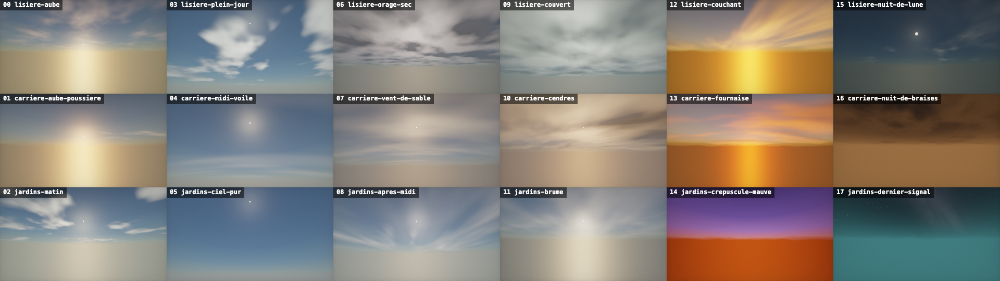

# FSky — ciel procédural en une passe (module ciel du lot 16)

`src/skies.js` expose le global `FSky` : un ciel procédural rendu en une seule passe plein écran WebGL2, sans aucune texture. C'est un module moteur générique de FERRO (MASTER-PROMPT §6) : son code ne cite aucun identifiant de METAL. Les 18 préréglages du jeu forment un bloc de données à part, en fin de fichier (CIEL-13).

**État : livré, testé, non branché.**

- Aucun fichier existant n'est modifié. `tools/build.py` ne charge pas `src/skies.js` ; `dist/index.html` et `SIZE.json` restent identiques à l'octet.
- `npm test` n'est pas touché : il ne lance ni `src/skies.js` ni `checks/fsky.test.mjs` (liste explicite de `package.json`). Référence de la base : 462 réussis sur 470 ; les 8 échecs sont les empreintes historiques de `checks/campaign-world.test.mjs` sur arm64.
- Le raccord dans le moteur est seulement décrit, au §7, pour le lot qui l'intégrera.

**Base et sources.**

- Branche `chantier/module-ciel`, partie de `71eca61` (`chantier/integration`). Pour `src/`, `tools/`, `checks/`, `dist/`, `SIZE.json` et `package.json`, cette base est identique à `main` (`363473a`).
- Les numéros de ligne cités ici sont ceux de cette base. Chaque point du §7 donne aussi un repère de texte, pour le retrouver si le fichier a bougé.
- Mission : fiche du lot « Module ciel ». Constats : [`docs/chantier-moteur/constats/CIEL.md`](../constats/CIEL.md). Tâches : [`docs/chantier-moteur/lots/lot-16.md`](../lots/lot-16.md). Décision de David du 12 novembre (MASTER-PROMPT §6 bis, point 6) : 18 ciels distincts, un par monde.

## 1. Résumé

**Ce que fait FSky.**

- **Une passe plein écran**, un seul triangle, aucune texture. Le shader de fragment fait tout : atmosphère, nuages, astres, crêtes d'horizon, tonalité du moteur, vignette et tramage.
- **Atmosphère.** La diffusion simple (Rayleigh, Mie, ozone, sur une Terre sphérique, constantes de Hillaire) est intégrée en JS **une fois par monde**, dans une table de 6 × 5 directions passée en uniformes. Le shader interpole la table et applique la phase de Mie à chaque pixel : le halo solaire reste net.
- **Résolution d'un monde** : exposition automatique ; source principale (soleil, lune ou aucune) ; **lumière clé** séparée de l'astre visible (CIEL-V2) ; **brouillard** tiré de l'horizon du ciel (CIEL-07).
- **Couches procédurales déterministes** :
  - nuages 2D et voile ;
  - étoiles et voie lactée, lune avec sa phase, disque solaire ;
  - crêtes d'horizon bornées (CIEL-V3) ;
  - tramage à la dernière écriture de la passe (CIEL-05) ;
  - masque alpha du disque solaire, en option (CIEL-V1).
- **18 préréglages METAL**, un par monde de campagne (CIEL-10).

**Pourquoi.** Le ciel actuel (`SKY_FRAG`, `src/renderer.js:452–492`) :

- n'a que 3 ciels pour 18 mondes ;
- fait des bandes, faute de tramage ;
- n'a pas de nuit crédible ;
- a un brouillard d'une autre couleur que son horizon ;
- calcule ses crêtes sur tout l'écran.

La mission a retenu une passe unique sans texture, plus simple et plus portable que les textures amorties du lot 16 (T2).

**Fichiers livrés.**

| fichier | rôle | octets |
|---|---|---:|
| [`src/skies.js`](../../../src/skies.js) | le module `FSky` (296 lignes) | 23 094 |
| [`checks/fsky.test.mjs`](../../../checks/fsky.test.mjs) | tests T1 à T17, hors `npm test` | 36 708 |
| [`tools/ciel/apercu.html`](../../../tools/ciel/apercu.html) | page autonome en `file://` : vue, planche, contrôle, banc, sonde | 18 441 |
| [`tools/ciel/rendu.mjs`](../../../tools/ciel/rendu.mjs) | pilote de Chrome sans tête : table, sonde, contrôle, captures, banc | 24 793 |
| [`docs/chantier-moteur/preuves/module-ciel/`](../preuves/module-ciel/) | 18 captures, planche, `rendu.json`, `README.md` | 5 531 928 |
| `docs/chantier-moteur/modules/ciel.md` | ce document | — |

**Commits** (`git log --oneline 71eca61..HEAD`) :

| étape | commit | message |
|---|---|---|
| 1 | `47ff9ca` | squelette FSky, conventions, validation et sources GLSL |
| 2 | `a22733f` | résolution atmosphérique, miroir JS, uniformes et 18 préréglages |
| 3 | `c587975` | tests de signature, de distinction et d'intention des 18 ciels |
| 4 | `c5af4a3` | page d'aperçu WebGL2 autonome (vue, planche, contrôle, banc) |
| 5 | `587f30e` | script de rendu sans interface (table, contrôle, captures, banc) |
| 6 et 7 | `4b43457` | preuves, 18 captures, planche, contrôle et mesures |
| 8 et 9 | commit de ce document | documentation du module et plan de branchement (non appliqué) ; la clôture (étape 9) ne touche aucun fichier |

**En chiffres.**

- **18 ciels distincts.** Distances minimales de signature entre deux mondes : 90 au total et 78 en couleur, pour des seuils de 60 et 30 (test T12).
- **Fidélité.** Le miroir JS rend les mêmes niveaux que le GPU : 0 niveau d'écart sur Apple M5 et SwiftShader, 1 sur NVIDIA GB10, pour une limite de 2 (8 640 points).
- **Coût, plein écran de ciel en 2560×1440.** De 1,05 à 1,37 fois l'ancien ciel sur M5 (0,950 ms), de 1,28 à 1,60 fois sur GB10 (0,177 ms). FSky coûte donc plus que l'ancien ciel, et non moins comme l'annonçait la fiche (§5.5).
- **`resolve`** : 0,42 ms au plus en JS, une fois par monde.
- **Taille** : 23 094 octets. `dist/index.html` passerait de 812 696 à 835 793 octets (build d'essai, §5.9), pour un budget de 1 400 000.

## 2. API

### 2.1 Forme du module

- IIFE au format de `src/motion.js` : `(function(G){'use strict'; … G.FSky={…};})(typeof window!=='undefined'?window:globalThis);`.
- Un seul global, `FSky` (test T1).
- Aucune dépendance. Le source ne contient ni `Math.random`, ni `Date`, ni `performance.now`, ni appel réseau, ni `</script` (test T2).
- Ordre du fichier :
  1. sources GLSL ;
  2. `UNIFORMS` ;
  3. `defaults`, `normalize`, `validate` ;
  4. physique et `resolve` ;
  5. miroir, `encode`, `signature` ;
  6. `view`, `frameUniforms`, `bind` ;
  7. bloc `// --- Données METAL (CIEL-13) ---` ;
  8. `G.FSky = {…}`.

### 2.2 Membres

| membre | signature ou type | renvoie, rôle |
|---|---|---|
| `VERSION` | nombre | `1` |
| `VERT` | chaîne GLSL (165 octets) | triangle plein écran tiré de `gl_VertexID`, à **z = w** : profondeur 1 |
| `FOG_GLSL` | chaîne GLSL (859 octets) | ses 5 uniformes (`uFskyRay`, `uFskyMie`, `uFskyRefH`, `uFskyRef`, `uFskyGlow`), puis `fskyPhase`, `fskyAtmos` et `fskyFog` ; sans `#version` ni `precision`, pour être inclus dans un autre shader |
| `FRAG` | chaîne GLSL (6 568 octets) | `'#version 300 es\nprecision highp float;\nprecision highp int;\n' + FOG_GLSL + …` : tout le ciel, sortie comprise |
| `UNIFORMS` | objet | `{nom: [type, nombre, genre]}` pour les 27 uniformes (§2.5) ; genre `'monde'` ou `'image'` |
| `defaults` | objet | préréglage complet par défaut (§3.1) |
| `presets` | tableau de 18 objets | les préréglages METAL ; l'index est le monde de campagne (§3.2) |
| `normalize(p)` | objet → objet | nouvel objet complet, fusionné clé à clé avec `defaults` ; les valeurs fournies sont gardées, même invalides ; tableaux copiés ; clés inconnues recopiées ; idempotente ; ne modifie ni `p` ni `defaults` |
| `validate(p)` | objet → chaînes | erreurs `"<chemin>: <raison>"` ; tableau vide si le préréglage est valide (§3.1) |
| `direction(el, az)` | degrés → `[x, y, z]` | vecteur unitaire (§2.3) |
| `view(yaw, pitch, fovY, aspect)` | radians → `{right, up, forward, fov}` | axes de `cameraAxes`, sans roulis, et `fov = [aspect·tan(fovY/2), tan(fovY/2)]` |
| `resolve(p, options)` | → état | résolution d'un monde (§2.4) ; lève une erreur si `validate` en trouve |
| `frameUniforms(camera, out = {})` | → `out` | les 8 uniformes d'image, en `Float32Array` créés une seule fois par `out` |
| `bind(gl, program, values, cache = {})` | → nombre d'appels | pose les uniformes de `UNIFORMS` présents dans `values` ; emplacements en cache, `null` compris ; n'appelle jamais `useProgram` |
| `radianceAt(state, d)` | → `[r, g, b]` | radiance linéaire du ciel sans ses couches : `fskyAtmos` au-dessus de l'horizon, `fskyFog` dessous |
| `fogAt(state, d)` | → `[r, g, b]` | miroir de `fskyFog` |
| `encode(rgb, vignette = 1)` | → 3 entiers de 0 à 255 | tonalité du moteur, puis vignette : `round(255·clamp(pow(x/(x+.76), .4545)·vignette, 0, 1))` |
| `signature(state)` | → 22 entiers | 15 niveaux encodés et 7 entiers du préréglage, pour le test T12 |

**Écarts à la fiche (§3).** Aucun sur les membres ni sur ce qu'ils rendent. `bind` accepte un `cache` absent (`{}` par défaut) : il redemande alors les emplacements à chaque appel. L'appelant doit donc garder un cache par programme.

### 2.3 Conventions

- **Repère.** Y vers le haut. `direction(el, az) = [cos el·sin az, sin el, −cos el·cos az]`, en degrés : l'azimut 0 regarde vers −Z, l'azimut 90 vers +X.
- **Caméra.** Ce sont les axes de `cameraAxes` (`src/renderer.js:716–721`), avec yaw et pitch en radians :
  - right = `[cos yaw, 0, sin yaw]` ;
  - up = `[−sin yaw·sin pitch, cos pitch, cos yaw·sin pitch]` ;
  - forward = `[sin yaw·cos pitch, sin pitch, −cos yaw·cos pitch]`.

  `view` n'a pas de roulis. Dans le moteur, on passe directement les axes de `cameraAxes`, qui l'ont.
- **Rayon d'un pixel.** `normalize(forward + right·u·fov[0] + up·v·fov[1])`, avec `u, v = vUV·2 − 1`, aux centres des pixels. `fov` est le `[width/height/f, 1/f]` du moteur, avec `f = 1/tan(fovY/2)`.
- **Sortie de `FRAG`**, dans cet ordre, comme `SKY_FRAG` :
  1. tonalité du moteur, `c/(c + .76)`, puis puissance `.4545` ;
  2. vignette `mix(post.x, 1, pow(max(0, 16·x·y·(1−x)·(1−y)), .13))`, avec `(x, y) = vUV` ; l'ancien ciel prend `.76` ;
  3. tramage triangulaire de ±1 niveau, multiplié par `post.y` ;
  4. écriture.
- **Alpha.** Il vaut 1, sauf si `post.z` vaut 1 : il porte alors le masque du disque solaire (CIEL-V1). Le masque vaut 0 sur l'atmosphère, les nuages et les crêtes ; sur le soleil, il suit la couverture du disque, bord anticrénelé compris.
- **Unités des préréglages.** Élévations, azimuts, rayons angulaires (`size`) et `glow.width` en degrés ; `camera.time` en secondes.

### 2.4 `resolve` et l'état d'un monde

`resolve(p, options = {})` procède ainsi :

1. `q = normalize(p)`. Si `validate(q)` n'est pas vide : `throw new Error('FSky.resolve: ' + erreurs.join('; '))`.
2. Graine effective : `seed = ((Math.imul(options.seed|0, 7919) + q.seed) >>> 0) % 65536`. Elle ne change que `uFskySeed`, c'est-à-dire la place des nuages et des étoiles (test T16).
3. Plancher de la lumière clé : `options.lightFloor ?? 18`, en degrés.
4. Table, exposition, disques, nuages et uniformes de monde (§4).

L'état renvoyé est `{id, preset, principal, exposure, seed, sun, moon, light, fog, uniforms}` :

| champ | contenu |
|---|---|
| `id` | `q.id`, ou `''` |
| `preset` | `q`, le préréglage normalisé |
| `principal` | `'sun'` si le soleil est à −8° ou plus ; sinon `'moon'` si la lune est à −2° ou plus ; sinon `'none'` |
| `exposure` | `key` / luminance moyenne de la table ; 1 sans source principale |
| `seed` | la graine effective |
| `sun`, `moon` | directions unitaires des astres |
| `light` | lumière clé (CIEL-V2) : `direction(max(élévation de la source, lightFloor), azimut de la source)`. La source est la source principale, ou le soleil s'il n'y en a pas. |
| `fog` | moyenne de `fogAt` sur 16 azimuts, de 22,5° en 22,5° : une couleur de brouillard unique pour le moteur (CIEL-07) |
| `uniforms` | les 19 uniformes de monde, en `Float32Array` |

Mêmes préréglage et options donnent le même état (tests T7 et T16). `resolve` ne modifie ni `p` ni `FSky.presets` (test T7).

### 2.5 Uniformes (27)

`FRAG` déclare exactement ces 27 uniformes (test T3), soit 85 vecteurs : 77 de monde et 8 d'image. `FOG_GLSL` déclare les 5 premiers uniformes de monde, soit 63 vecteurs. OpenGL ES 3.0 garantit 224 vecteurs d'uniformes de fragment ; le M5 en offre 1 024, le GB10 4 096.

**Genre `'image'`**, posés à chaque image par `frameUniforms` :

| nom | type | contenu |
|---|---|---|
| `uFskyRight`, `uFskyUp`, `uFskyForward` | vec3 | axes de la caméra |
| `uFskyFov` | vec2 | `fov` |
| `uFskyTime` | float | secondes ; seule entrée du temps, pour la dérive des nuages |
| `uFskyPixel` | float | taille angulaire d'un pixel, `2·fov[1]/height` |
| `uFskyPost` | vec4 | `(vignette, tramage, masque, 0)` ; par défaut `(1, 1, 0, 0)` |
| `uFskyLayers` | vec4 | couches, 0 ou 1 : nuages, astres de nuit (étoiles, voie lactée, lune), soleil, crêtes ; par défaut `(1, 1, 1, 1)` |

**Genre `'monde'`**, calculés par `resolve`, une fois par monde :

| nom | type | contenu |
|---|---|---|
| `uFskyRay` | vec3[30] | table de Rayleigh, phase et diffusion multiple approchée comprises, exposée et étalonnée (`grade`), plancher `floor` ajouté |
| `uFskyMie` | vec3[30] | table de Mie, sans sa phase, exposée et étalonnée |
| `uFskyRefH` | vec2 | azimut de la source principale, en direction horizontale `(sin az, −cos az)` |
| `uFskyRef` | vec4 | direction de la source principale (xyz) et `g` de Mie (w) |
| `uFskyGlow` | vec4 | halo d'horizon : couleur × force (rgb), `1/sin(width)` (a) |
| `uFskySun`, `uFskyMoon` | vec3 | directions du soleil et de la lune |
| `uFskySunDisc`, `uFskyMoonDisc` | vec4 | couleur (rgb) et rayon en radians (a) ; rayon nul sous −2° |
| `uFskyMoonRight`, `uFskyMoonUp` | vec3 | repère du disque lunaire |
| `uFskyCloud` | vec4 | nuages : `cover`, `soft`, `opacity`, `scale` |
| `uFskyCloud2` | vec4 | nuages : `stretch`, `dark`, `veil`, `curve` |
| `uFskyCloudSun`, `uFskyCloudAmb` | vec3 | lumière directe et lumière ambiante des nuages |
| `uFskyWind` | vec4 | vitesse de dérive, 0, direction horizontale du vent |
| `uFskySeed` | vec4 | décalages des nuages, rotation des étoiles, graine des étoiles |
| `uFskyStars` | vec4 | éclat des étoiles, part des cellules étoilées (0,02), éclat de la voie lactée, 0 |
| `uFskyHorizon` | vec4 | crêtes : `far`, `near`, `mix`, `dark` |

### 2.6 Clés de CIEL-11, CIEL-V2 et CIEL-V3

CIEL-11 proposait un champ `atmosphere.sky` lu par `FRender`. FSky rend le même service par un module à part, et ses clés deviennent :

| proposition des constats | FSky | remarque |
|---|---|---|
| `sun: {elevation, azimuth}` | `sun: {el, az, size, bright}` | rayon et éclat du disque en plus |
| `moon: {elevation, azimuth}` | `moon: {el, az, size, bright}` | |
| `turbidity`, `ozone` | `turbidity`, `ozone` | plus `rayleigh` (densité) et `multi` (diffusion multiple approchée) |
| `aerosol: {tint, absorb, g}` | `tint`, `absorb`, `g` | au premier niveau |
| `groundAlbedo` | — | pas de rebond du sol |
| `clouds: {cover, type, base, thickness, density, scale, erosion, tint}` | `clouds: {cover, soft, opacity, scale, stretch, dark, veil, curve, tint}` | une couche 2D et un voile, pas de volume |
| `wind: {direction, speed}` | `wind: {dir, speed}` | |
| `stars` | `stars`, `milky` | |
| `exposure`, `'auto'` ou nombre | `key` | exposition automatique : `key` / luminance moyenne |
| — | `grade`, `floor` | étalonnage par canal, plancher de nuit |
| — | `glow: {color, strength, width}` | halo d'horizon (braises, signal) |
| `seed` | `seed`, et `options.seed` de `resolve` | |
| `shadows: {scale}` | — | pas d'ombres de nuages (T17) |
| `key`, direction d'éclairage (CIEL-V2) | `state.light` et `options.lightFloor` | |
| `horizon` (CIEL-V3) | `horizon: {far, near, mix, dark}` | `far: 0` retire la couche |
| `create(canvas, {sky: {dome, slices, tone, dither}})` | `frameUniforms({…, dither, layers, vignette, mask})` | pas de dôme ; tonalité du moteur |
| `renderer.sky = {sunColor, ambient, exposure}` | `state.exposure`, `state.light`, `state.fog` | ni `sunColor` ni `ambient` (T12) |
| `FRender.skyPresets` (7) | `FSky.presets` (18) | les valeurs appartiennent au jeu (CIEL-13) |

## 3. Préréglages

### 3.1 Schéma et bornes

`validate` contrôle trois choses :

- les types : nombres finis, ou triplets de nombres finis ;
- les bornes ci-dessous, incluses ;
- les clés inconnues, à tous les niveaux.

Les valeurs omises viennent de `defaults`.

| champ | bornes | défaut |
|---|---|---|
| `id` (facultatif) | `/^[a-z0-9]+(-[a-z0-9]+)*$/` | — |
| `name` (facultatif) | 1 à 40 caractères | — |
| `sun.el`, `moon.el` | [−90, 90] | 30 ; −30 |
| `sun.az`, `moon.az` | [−360, 360] | 0 ; 180 |
| `sun.size` | [0,1 ; 5] | 0,7 |
| `sun.bright` | [0, 50] | 8 |
| `moon.size` | [0,1 ; 6] | 0,6 |
| `moon.bright` | [0, 20] | 3 |
| `turbidity` | [0,5 ; 15] | 2 |
| `absorb` | [0 ; 0,95] | 0,1 |
| `tint` | 3 × [0, 2] | (1, 1, 1) |
| `g` | [0 ; 0,95] | 0,8 |
| `rayleigh` | [0,1 ; 4] | 1 |
| `ozone` | [0, 4] | 1 |
| `multi` | [0, 1] | 0,25 |
| `key` | [0,005 ; 0,6] | 0,25 |
| `grade` | 3 × [0,2 ; 2,5] | (1, 1, 1) |
| `floor` | 3 × [0 ; 0,1] | (0, 0, 0) |
| `clouds.cover`, `clouds.opacity`, `clouds.dark`, `clouds.veil` | [0, 1] | 0,35 ; 0,95 ; 0,5 ; 0 |
| `clouds.soft` | [0,01 ; 0,6] | 0,18 |
| `clouds.scale` | [0,1 ; 5] | 1 |
| `clouds.stretch` | [1, 8] | 1 |
| `clouds.curve` | [0,02 ; 0,6] | 0,15 |
| `clouds.tint` | 3 × [0, 2] | (1, 1, 1) |
| `wind.dir` | [−360, 360] | 30 |
| `wind.speed` | [0, 10] | 1 |
| `stars`, `milky` | [0, 1] | 0 ; 0 |
| `glow.color` | 3 × [0, 2] | (1 ; 0,4 ; 0,1) |
| `glow.strength` | [0, 1] | 0 |
| `glow.width` | [1, 45] | 6 |
| `horizon.far` | [0 ; 0,2] | 0,07 |
| `horizon.near` | [0 ; 0,15], et `near ≤ far` (sinon erreur au chemin `horizon`) | 0,035 |
| `horizon.mix` | [0, 1] | 0,5 |
| `horizon.dark` | [0, 2] | 1 |
| `seed` | entier de [0, 65535] | 7 |

### 3.2 Les 18 mondes de campagne

- Biome = `index % 3`, chapitre = `floor(index / 3)` (`src/world.js:5–9`, `:36–39` et `:654`). La graine de chaque préréglage vaut `index·101 + 7`.
- Azimut de la source principale selon le biome : lisière −127°, carrière −61°, jardins 28°. Ce sont les directions de soleil de `src/world.js:646–648` ; seul le monde 17 s'en écarte (§7.9, point 8).
- **Intention** : groupe et classes de couleur permises par l'annexe E de la fiche (test T13), pour le zénith puis pour le brouillard. Règles de clarté :
  - jour (0 à 11) : V(zénith) ≥ 0,28, V(brouillard) ≥ 0,45, S(brouillard) ≤ 0,45 ;
  - crépuscule (12 à 14) : 0,20 ≤ V(zénith) ≤ 0,45, S(brouillard) ≥ 0,50 ;
  - nuit (15 à 17) : V(zénith) ≤ 0,22.
- **Zénith et brouillard** : couleurs encodées, mesurées par `node tools/ciel/rendu.mjs --table`. Les 18 mondes respectent leur intention.

| index | id | nom | biome | chapitre | source principale | `key` | exposition | intention : zénith ; brouillard | zénith | brouillard |
|---:|---|---|---|---|---|---:|---:|---|---|---|
| 0 | `lisiere-aube` | Aube pâle | lisière | L’Éveil des forges | soleil à 8° | 0,20 | 8,23 | jour : bleu ; orange ou jaune | `#324053` | `#b9a47c` |
| 1 | `carriere-aube-poussiere` | Aube de poussière | carrière | L’Éveil des forges | soleil à 10° | 0,22 | 9,21 | jour : bleu ; orange ou jaune | `#3b4554` | `#bea278` |
| 2 | `jardins-matin` | Matin clair | jardins | L’Éveil des forges | soleil à 22° | 0,24 | 6,70 | jour : bleu ; gris | `#33475f` | `#a5a598` |
| 3 | `lisiere-plein-jour` | Plein jour | lisière | La Garde de fer | soleil à 55° | 0,26 | 7,04 | jour : bleu ; gris | `#445c77` | `#969f9c` |
| 4 | `carriere-midi-voile` | Midi voilé | carrière | La Garde de fer | soleil à 50° | 0,27 | 7,17 | jour : bleu ; gris | `#465a72` | `#979a96` |
| 5 | `jardins-ciel-pur` | Ciel pur | jardins | La Garde de fer | soleil à 62° | 0,24 | 6,47 | jour : bleu ; gris | `#465f7f` | `#949c9b` |
| 6 | `lisiere-orage-sec` | Orage sec | lisière | La Chasse mécanique | soleil à 32° | 0,14 | 3,68 | jour : bleu ; gris | `#2d3b4f` | `#80807b` |
| 7 | `carriere-vent-de-sable` | Vent de sable | carrière | La Chasse mécanique | soleil à 36° | 0,20 | 6,27 | jour : bleu ; gris ou orange | `#3f4c60` | `#89827c` |
| 8 | `jardins-apres-midi` | Après-midi de cirrus | jardins | La Chasse mécanique | soleil à 30° | 0,25 | 6,67 | jour : bleu ; gris | `#374b65` | `#9ea19b` |
| 9 | `lisiere-couvert` | Couvert | lisière | Les Forges brisées | soleil à 40° | 0,18 | 4,67 | jour : bleu ; gris | `#33465c` | `#818885` |
| 10 | `carriere-cendres` | Ciel de cendres | carrière | Les Forges brisées | soleil à 24° | 0,17 | 6,49 | jour : bleu ; orange | `#3a4556` | `#9a8574` |
| 11 | `jardins-brume` | Brume claire | jardins | Les Forges brisées | soleil à 18° | 0,21 | 6,96 | jour : bleu ; gris ou orange | `#36455b` | `#9e9688` |
| 12 | `lisiere-couchant` | Couchant doré | lisière | La Fournaise | soleil à 2° | 0,22 | 25,9 | crépuscule : gris, bleu ou violet ; orange | `#4b4b53` | `#cd892b` |
| 13 | `carriere-fournaise` | Fournaise | carrière | La Fournaise | soleil à 0,5° | 0,22 | 58,9 | crépuscule : gris ou violet ; orange ou rouge | `#5d555e` | `#b86227` |
| 14 | `jardins-crepuscule-mauve` | Crépuscule mauve | jardins | La Fournaise | soleil à −4,5° | 0,08 | 662 | crépuscule : violet ; rouge ou orange | `#312251` | `#8f330b` |
| 15 | `lisiere-nuit-de-lune` | Nuit de lune | lisière | Le Dernier signal | lune à 30° | 0,03 | 0,802 | nuit : bleu ; gris ou cyan | `#1e2934` | `#464e4c` |
| 16 | `carriere-nuit-de-braises` | Nuit de braises | carrière | Le Dernier signal | aucune (soleil à −25°, lune à −20°) | — | 1 | nuit : rouge ou orange ; orange | `#271c17` | `#986d41` |
| 17 | `jardins-dernier-signal` | Dernier signal | jardins | Le Dernier signal | aucune (soleil à −35°, lune à −10°) | — | 1 | nuit : bleu ; cyan | `#18212a` | `#3f7c80` |

Sans source principale (mondes 16 et 17), `key` n'est pas utilisé et l'exposition vaut 1.

### 3.3 Règle CIEL-13 : les valeurs appartiennent au jeu

- Le modèle et l'API sont au moteur, les valeurs au jeu (CIEL-13, règle de FERRO).
- Dans `src/skies.js`, les préréglages forment le dernier bloc, après `// --- Données METAL (CIEL-13) ---` ; le code générique ne cite aucun identifiant METAL.
- **Valeurs figées** (fiche, R6). L'orchestrateur les a validées à l'œil sur le prototype ; elles sont reprises à la valeur près (seuls les zéros de tête tombent : `0.2` devient `.2`). Aucun test n'a été affaibli pour elles.
- **Décision à prendre à l'intégration** : garder ce bloc dans `src/skies.js`, ou le passer dans le jeu (`src/world.js` ou `src/game.js`).
  - Dans `src/world.js`, la table ne doit pas entrer dans l'objet monde : `checks/campaign-world.test.mjs:15` en hache le JSON entier, empreintes historiques comprises (lignes 179, 186 et 202).
  - Valeur par défaut proposée : garder le bloc tant que METAL est le seul jeu servi par FSky ; le sortir du module quand un deuxième jeu l'adopte (BITUME, Point de rupture : T16).

## 4. Modèle

### 4.1 Diffusion simple et constantes

- **Géométrie.** Terre sphérique de 6 360 km de rayon, sommet de l'atmosphère à 6 460 km, observateur à 0,2 km.
- **Coefficients**, par km (Hillaire) :
  - Rayleigh : `(5,802 ; 13,558 ; 33,1)·10⁻³ × rayleigh`, densité `exp(−h/8)` ;
  - Mie : extinction `3,996·10⁻³ × 1,11 × turbidity`, diffusion `extinction × (1 − absorb) × tint`, densité `exp(−h/1,2)` ;
  - ozone : `(0,650 ; 1,881 ; 0,085)·10⁻³ × ozone`, densité en tente `max(0, 1 − |h − 25|/15)`.
- **Intégration.**
  - Le long du rayon de vue : 32 pas d'espacement quadratique (`t = L·(i/N)²`).
  - Vers la source : 12 pas, de même. Un point dont la source est cachée par le sol ne contribue pas.
- **Phases.** La table stocke Rayleigh avec sa phase, `3/(16π)·(1 + μ²)`, et Mie sans la sienne. Le shader applique à chaque pixel la phase de Cornette-Shanks (`fskyPhase`), avec le `g` du préréglage : le halo solaire reste net, quelle que soit la finesse de la table.

### 4.2 Table de 6 × 5 directions

- **Lignes** : `y = (r/5)²`, pour r de 0 à 5. Le sinus de l'élévation vaut 0 ; 0,04 ; 0,16 ; 0,36 ; 0,64 et 1 : les lignes se serrent près de l'horizon.
- **Colonnes** : `cos Δaz = 1 − k/2`, pour k de 0 à 4, soit Δaz = 0°, 60°, 90°, 120° et 180° autour de l'azimut de la source principale. Le ciel est supposé symétrique de part et d'autre de cet azimut.
- **Lecture** (`fskyAtmos`) : `r = 5·√y` et `k = 2·(1 − cos Δaz)`, puis une interpolation bilinéaire dans chaque table. S'y ajoutent Mie × phase et le halo d'horizon, `glow·exp(−y/sin width)`.

### 4.3 Diffusion multiple approchée, exposition et source principale

- **Diffusion multiple approchée.** Chaque cellule de Rayleigh reçoit `multi` × la moyenne de sa ligne (Rayleigh + Mie × 1/4π). Ce n'est pas la table de Hillaire (§9.1).
- **Exposition automatique.** `key` / luminance moyenne (Rec. 709) des 30 cellules, Mie pondérée par 1/4π. Puis `grade` par canal ; le plancher `floor` s'ajoute à la table de Rayleigh.
- **Source principale.** Le soleil s'il est à −8° ou plus ; sinon la lune si elle est à −2° ou plus ; sinon aucune. Sans source, la table vaut le plancher et l'exposition 1 : le ciel se réduit au plancher, au halo d'horizon, aux astres de nuit et aux nuages, éclairés par la seule lumière ambiante.
- **Disques**, au-dessus de −2° seulement. Teinte : transmittance de l'observateur vers l'astre, normalisée par son maximum, × `bright`. La lune est légèrement bleutée, (0,95 ; 0,97 ; 1).
- **Lumière des nuages.**
  - Directe : transmittance depuis 2,5 km vers la source × 0,27 × exposition × `grade` × `clouds.tint`.
  - Ambiante : (0,85 × moyenne de la table + 0,3 × halo) × `clouds.tint`.
- **Lumière clé** (CIEL-V2) : même azimut que la source, élévation relevée au plancher `lightFloor` (18° par défaut, d'où `light[1] ≥ sin 18° = 0,309`). Sans source principale, c'est l'azimut du soleil qui sert.

### 4.4 Brouillard cohérent (CIEL-07)

- `fskyFog(d)` lit la ligne d'horizon de la table dans l'azimut de `d` : c'est `fskyAtmos` de la direction horizontale de `d`, Mie, phase et halo compris.
- Sous l'horizon, le ciel vaut exactement `fskyFog(d)`. Il est continu à l'horizon (test T10), et ne dépend plus que de l'azimut.
- `state.fog` est la moyenne de 16 azimuts : c'est la couleur de brouillard unique proposée au moteur dans un premier temps (§7.3).
- `FOG_GLSL` s'inclut tel quel dans un autre shader, celui du monde ou celui des fx (§7.8).

### 4.5 Couches procédurales

Toutes sont déterministes : hachages de Hoskins et PCG, aucune texture, aucun hasard. Chacune se coupe par `uFskyLayers`.

- **Nuages** (couche x).
  - Plan incurvé : `p = d.xz / (d.y + curve) × scale`, tourné vers le vent, étiré de `stretch` le long du vent, dérivant de 0,006 × `speed` par seconde, décalé par la graine.
  - Forme : bruit de valeur à 4 octaves ; couverture `smoothstep(1 − cover ± soft)` × `opacity`, fondue au ras de l'horizon (sur 0,08 de `d.y`).
  - Ombrage : 2 octaves décalées vers la source ; phase de Henyey-Greenstein (g = 0,6) ; `dark` assombrit les nuages épais ; mélange vers le ciel près de l'horizon.
  - Voile : 2 octaves étirées, × `veil`.
- **Astres de nuit** (couche y).
  - Étoiles : grille de cube de 160 × 160 cellules par face ; une cellule sur 50 porte une étoile, soit environ 3 070 étoiles. Ce sont des taches gaussiennes d'environ 0,75 pixel de rayon, d'éclat en loi de puissance, de teinte mêlée entre un blanc chaud et un blanc bleuté. Elles sont éteintes quand le soleil est au-dessus de 0°, à plein éclat sous −10°, et cachées par les nuages.
  - Voie lactée : bande gaussienne, modulée par un bruit à 3 octaves.
  - Lune : normale reconstruite, phase donnée par la vraie direction du soleil, mers par un bruit à 3 octaves, bord anticrénelé, léger halo.
- **Soleil** (couche z).
  - Rayon `size` : 0,7° par défaut, contre environ 1,9° pour l'ancien disque.
  - Assombrissement au bord `1 − u·(1 − √(1 − r²))`, avec u = (0,50 ; 0,62 ; 0,78), et bord anticrénelé sur 1,5 pixel.
  - Caché par les nuages et sous l'horizon.
- **Crêtes d'horizon** (couche w, CIEL-V3).
  - Calculées seulement là où `d.y < horizon.far`.
  - Deux silhouettes de bruit le long de l'azimut, anticrénelées sur 1,5 pixel. La lointaine mêle brouillard et ciel (`mix`) ; la proche est le brouillard × `dark`.

### 4.6 Tonalité, vignette, tramage et déterminisme

- **Tonalité** : la courbe du moteur, `c/(c + .76)` puis `.4545`. `encode` la reproduit, comme `skyColor` du repli logiciel (`src/renderer.js:805`).
- **Tramage** (CIEL-05) : `(h(p) + h(p + (113,5 ; 37,25)) − 1)/255`, avec `p = gl_FragCoord.xy`, posé après le gamma et la vignette, à la dernière écriture de la passe. `dither: 0` le coupe, pour les tests au pixel près.
- **Hygiène du GLSL.**
  - Le test T3 vérifie : ni `texture(`, ni `sampler`, ni dérivées, ni `fract(sin(` ; toutes les fonctions préfixées `fsky` ; les sources identiques à l'octet à la référence (empreintes SHA-256).
  - À la lecture : `smoothstep` toujours avec e0 < e1 ; `pow` jamais sur une base négative ; `uint` jamais d'un flottant négatif ; `normalize` jamais sur un vecteur nul.
- **Déterminisme.** Le temps n'entre que par `uFskyTime`, pour la dérive des nuages. Ni `Math.random`, ni horloge. Aucun effet sur la simulation : le ciel n'est que du rendu.

## 5. Coût

### 5.1 Protocole (`--banc`, §6.1 de la fiche)

- **Cadrage** : plein écran de ciel, fov 75°, pitch 40°, yaw sur la source principale (0 pour l'ancien ciel).
- **Échantillon** : `passes` tracés dans deux cibles RGBA8 en alternance, puis `readPixels` 1 × 1, seule synchronisation fiable.
- **Tours** : 3 de chauffe, puis 40 ; l'ordre des variantes tourne à chaque tour.
- **Écart** : échantillon de la variante − échantillon d'un remplissage uni du même tour, en ms par passe. On donne la médiane des écarts et leur plage p10–p90.
- **Rapport** : médiane de la variante / médiane de l'ancien ciel.
- **Variantes** :
  - `ancien` : `SKY_FRAG` du jeu, environnement « woodland » ;
  - `fsky-jour` : monde 3 ; `fsky-couvert` : monde 9 ; `fsky-nuit` : monde 17 ;
  - `fsky-atmo` : monde 3, couches `0000`.
- **Garde-fou** : le banc vérifie d'abord que la copie de l'ancien ciel dans `apercu.html` est celle de `src/renderer.js`.

### 5.2 GPU : Apple M5 (ANGLE Metal), moteur principal

MacBook Air M5, Chrome 157, 6 passes par échantillon. Les bancs retenus ont tourné au repos, en état thermique « nominal » ; les conditions sont dans le [README des preuves](../preuves/module-ciel/README.md).

| variante | 2560×1440 : médiane (p10–p90) | rapport | 1792×1008 : médiane (p10–p90) | rapport |
|---|---|---:|---|---:|
| ancien | 0,950 ms (0,933–1,067) | 1 | 0,500 ms (0,450–0,617) | 1 |
| fsky-jour | 1,000 ms (0,950–1,150) | 1,053 | 0,500 ms (0,483–0,667) | 1,000 |
| fsky-couvert | 1,150 ms (1,133–1,283) | 1,211 | 0,583 ms (0,567–0,783) | 1,166 |
| fsky-nuit | 1,300 ms (1,267–1,433) | 1,368 | 0,667 ms (0,633–0,933) | 1,334 |
| fsky-atmo | 0,283 ms (0,250–0,317) | 0,298 | 0,167 ms (0,133–0,200) | 0,334 |

1792×1008, environ 1,8 Mpix, est le plafond de la qualité « auto » du moteur.

### 5.3 GPU : NVIDIA GB10 (ANGLE Vulkan)

Spark (Linux arm64), Chrome 151, pilote 580.173.02, 30 passes par échantillon. Avec 6 passes, un échantillon de l'ancien ciel ne durerait qu'environ 1 ms, pour une horloge de page qui avance par pas de 0,1 ms.

| variante | 2560×1440 : médiane (p10–p90) | rapport | 1792×1008 : médiane (p10–p90) | rapport |
|---|---|---:|---|---:|
| ancien | 0,177 ms (0,157–0,197) | 1 | 0,093 ms (0,077–0,113) | 1 |
| fsky-jour | 0,227 ms (0,210–0,243) | 1,282 | 0,117 ms (0,100–0,127) | 1,258 |
| fsky-couvert | 0,253 ms (0,243–0,277) | 1,429 | 0,137 ms (0,117–0,153) | 1,473 |
| fsky-nuit | 0,283 ms (0,270–0,300) | 1,599 | 0,147 ms (0,137–0,167) | 1,581 |
| fsky-atmo | 0,073 ms (0,057–0,090) | 0,412 | 0,037 ms (0,027–0,053) | 0,398 |

### 5.4 Rendu logiciel : SwiftShader

SwiftShader n'a servi qu'au contrôle miroir (§6.2), réussi à 0 niveau d'écart. Il n'a pas de banc : ses temps seraient des coûts de processeur, sans rapport avec ceux d'un GPU. La fiche ne demande ce banc qu'à défaut de GPU (§6.1), et les deux machines en avaient un.

### 5.5 Le tableau du §1.4 de la fiche ne se reproduit pas

Le §1.4 rapportait le prototype à un ancien ciel de 1,58 ms : c'est le chiffre de l'audit (constat CIEL), mesuré dans une autre session. Mesuré dans le même processus et en alternance, l'ancien ciel vaut 0,950 ms sur le M5. **FSky coûte donc plus que l'ancien ciel, pas moins.**

| cas, 2560×1440 | annoncé au §1.4 (M5) | mesuré, M5 | mesuré, GB10 |
|---|---|---|---|
| ancien ciel | 1,58 ms (1) | 0,950 ms (1) | 0,177 ms (1) |
| jour nuageux | 0,95 ms (0,60) | 1,000 ms (1,053) | 0,227 ms (1,282) |
| couvert | 1,22 ms (0,77) | 1,150 ms (1,211) | 0,253 ms (1,429) |
| nuit étoilée | 0,82 ms (0,52) | 1,300 ms (1,368) | 0,283 ms (1,599) |
| atmosphère seule | 0,28 ms | 0,283 ms | 0,073 ms |

- **Ce qui diffère.** Les coûts absolus de FSky de jour, couvert et en atmosphère seule sont proches de ceux annoncés : c'est la référence qui ne tient pas. La nuit, elle, annoncée à 0,82 ms, en coûte 1,30.
- **Charge du Mac.** Sur le Mac partagé, 23 passages en 2560×1440 ont donné un ancien ciel de 0,95 à 1,92 ms selon la charge et l'état thermique. Les rapports, eux, restent dans la même bande : jour de 0,96 à 1,08, couvert de 1,14 à 1,27, nuit de 1,30 à 1,45.
- **Surcoût absolu**, sur un écran entièrement couvert de ciel :
  - M5 : de +0,05 ms (jour) à +0,35 ms (nuit) en 2560×1440 ; de 0 à +0,17 ms en 1792×1008 ;
  - GB10 : de +0,05 à +0,11 ms en 2560×1440 ; de +0,02 à +0,05 ms en 1792×1008.
- **En jeu.** Le ciel est aujourd'hui dessiné en premier, sur tout l'écran, sans test de profondeur (`src/renderer.js:1567`). La passe coûte donc son plein écran à chaque image, quel que soit le décor : ce surcoût est celui du jeu si l'on branche FSky sans changer l'ordre de dessin.
- **Ciel après l'opaque** (§7.6). Le ciel ne coûterait plus que ses pixels visibles. Avec 30 à 50 % de ciel visible (part estimée dans les constats, `CIEL.md`), FSky coûterait de 0,30 ms (jour) à 0,65 ms (nuit) sur le M5 en 2560×1440, contre 0,950 ms pour l'ancien ciel dessiné en premier. C'est une estimation, à mesurer au branchement.

### 5.6 Objectifs du §6.1 et leviers

| variante | objectif | limite | M5 2560×1440 | M5 1792×1008 | GB10 2560×1440 | GB10 1792×1008 |
|---|---|---|---|---|---|---|
| fsky-jour | ≤ 1,0 | ≤ 1,15 | 1,053 : objectif manqué, limite tenue | 1,000 : tenus | 1,282 : limite dépassée | 1,258 : limite dépassée |
| fsky-couvert | — | ≤ 1,15 | 1,211 : dépassée | 1,166 : dépassée | 1,429 : dépassée | 1,473 : dépassée |
| fsky-nuit | ≤ 1,0 | — | 1,368 : manqué | 1,334 : manqué | 1,599 : manqué | 1,581 : manqué |

Les limites étant dépassées, les deux leviers du §6.1 ont été mesurés, sur des variantes de `FRAG` construites par la page, sans toucher à `FSky.FRAG` :

- **L1** : forme des nuages, `fskyFbm(p,4)` devient `fskyFbm(p,3)` ;
- **L2** : ombrage des nuages, `fskyFbm(p+sd*.35,2)` devient `fskyFbm(p+sd*.35,1)`.

Passage dédié aux leviers, en 2560×1440 ; ses valeurs sans levier diffèrent un peu de celles des §5.2 et 5.3 (couvert à 1,228 contre 1,211 sur le M5 ; ancien ciel à 0,170 ms contre 0,177 sur le GB10).

| rapport à l'ancien ciel | M5 (6 passes) | GB10 (30 passes) |
|---|---|---|
| jour : sans levier ; L1 ; L1+L2 | 1,053 ; 0,913 ; 0,860 | 1,335 ; 1,176 ; 1,118 |
| couvert : sans levier ; L1 ; L1+L2 | 1,228 ; 1,087 ; 0,965 | 1,453 ; 1,335 ; 1,194 |
| nuit : sans levier ; L1+L2 | 1,368 ; 1,245 | 1,647 ; 1,547 |

**Décision C6 : `FSky.FRAG` reste celui de la référence, sans levier.**

- Chaque levier retire une octave de détail aux nuages : c'est une perte de qualité, donc au mieux une option désactivée par défaut (MASTER-PROMPT §3, règle 2).
- Même avec L1+L2, le couvert du GB10 reste au-dessus de 1,15.
- Les signatures ne dépendent pas des nuages : une telle option ne toucherait ni le test T12 ni le contrôle miroir.

### 5.7 Coût par couche, de nuit

Même banc, monde 17, en 2560×1440. Une copie d'`apercu.html` hors du dépôt y ajoute quatre variantes à couches coupées ; la ligne ajoutée est citée dans le README des preuves. Le coût d'une couche vaut la nuit complète moins la nuit sans cette couche.

| couche | M5 (6 passes) | GB10 (30 passes) |
|---|---:|---:|
| nuit complète (`1111`) | 1,300 ms | 0,280 ms |
| nuages (`0111`) | 0,52 ms | 0,11 ms |
| astres : étoiles, voie lactée, lune (`1011`) | 0,45 ms | 0,09 ms |
| crêtes (`1110`) | 0,02 ms | 0 |
| atmosphère seule (`0000`) | 0,283 ms | 0,073 ms |
| ancien ciel, même passage | 0,967 ms | 0,173 ms |

- **Crêtes (CIEL-V3).** Bornées à `d.y < horizon.far`, elles ne coûtent presque rien. Dans l'ancien ciel, qui les calcule à chaque pixel, elles faisaient 27 % du coût.
- **Nuit.** Le surcoût vient des nuages et des astres, qui coûtent chacun plus que l'atmosphère. Les leviers ne touchent que les nuages ; pour les astres, la piste reste celle de CIEL-04, des étoiles dessinées en points (§8, T9).

### 5.8 Temps de `resolve` et des uniformes d'image

- **`resolve`**, une fois par changement de monde. Mesure de `node tools/ciel/rendu.mjs --table` : domaine principal de Node 24.18 sur le M5, 3 appels de chauffe, puis médiane de 21 appels par monde.
  - Au calme : 0,42 ms au plus (`lisiere-aube`) et 0,33 ms en moyenne ; relancé au début de l'étape 8 : 0,412 et 0,324 ms ; à la clôture : 0,406 et 0,325 ms.
  - Sous une charge de 6,3 : 0,88 et 0,72 ms.
  - Objectif 5 ms, limite 15 ms : tenus. Le §1.4 de la fiche annonçait 0,67 ms.
- **`frameUniforms`** : 48,5 ns par appel, et aucune allocation après le premier appel avec le même `out` : 0 passage du ramasse-miettes sur 2 000 000 appels (mesure de l'étape 2).
- **Par image**, la passe pose 8 uniformes d'image ; les 19 de monde ne sont posés qu'au changement de monde (§7.4).

### 5.9 Tailles

- **`src/skies.js`** : 23 094 octets. La limite de 24 000 est tenue, l'objectif de 20 000 manqué.
  - `FRAG` fait 6 568 octets, `FOG_GLSL` compris, et `VERT` 165 ; avec leurs déclarations, les sources GLSL figées pèsent 6 797 octets.
  - Le bloc des 18 préréglages fait 3 706 octets.
  - L'objectif de 20 000 octets n'est pas atteignable sans toucher au GLSL figé, ou sans rendre le JS illisible (étape 2).
- **Effet sur `dist/index.html`**, mesuré par un **build d'essai** hors du dépôt : export de HEAD, points 1 et 2 du §7 appliqués, `python3 tools/build.py`. Rien n'est commité.
  - 812 696 → **835 793 octets**, soit +23 097 : `skies.js` et le séparateur de 3 octets (`\n;\n`) de `build.py`. C'est 59,7 % du budget de 1 400 000.
  - En gzip : 245 325 → 254 755 octets.
  - `node checks/build.test.mjs`, avec `FSky` ajouté aux globaux exigés : PASS.
- **Retirer un jour `SKY_FRAG`** : −2 021 octets pour sa seule déclaration (`src/renderer.js:452–492`). La fiche estime environ 2,3 ko avec le code qui la sert, lequel serait alors remplacé par les appels à FSky.
- **Preuves** : 19 images pour 5 495 074 octets ; `rendu.json` fait 15 166 octets.

## 6. Preuves

### 6.1 Fichiers

Dossier [`docs/chantier-moteur/preuves/module-ciel/`](../preuves/module-ciel/), tout rendu par le M5 :

- [`README.md`](../preuves/module-ciel/README.md) : matériel, drapeaux, commandes exactes, conditions des bancs, relecture visuelle ;
- [`rendu.json`](../preuves/module-ciel/rendu.json) : contrôle, captures et bancs du M5 ; GB10 et SwiftShader sous la clé `autres` ;
- [`planche.png`](../preuves/module-ciel/planche.png) : les 18 ciels en vignettes de 320×180 (colonne = chapitre, ligne = biome) ;
- 18 captures de 800×450, rangées ici comme la planche, par chapitre et par biome :

| chapitre | lisière | carrière | jardins |
|---|---|---|---|
| L’Éveil des forges | [00 `lisiere-aube`](../preuves/module-ciel/monde-00-lisiere-aube.png) | [01 `carriere-aube-poussiere`](../preuves/module-ciel/monde-01-carriere-aube-poussiere.png) | [02 `jardins-matin`](../preuves/module-ciel/monde-02-jardins-matin.png) |
| La Garde de fer | [03 `lisiere-plein-jour`](../preuves/module-ciel/monde-03-lisiere-plein-jour.png) | [04 `carriere-midi-voile`](../preuves/module-ciel/monde-04-carriere-midi-voile.png) | [05 `jardins-ciel-pur`](../preuves/module-ciel/monde-05-jardins-ciel-pur.png) |
| La Chasse mécanique | [06 `lisiere-orage-sec`](../preuves/module-ciel/monde-06-lisiere-orage-sec.png) | [07 `carriere-vent-de-sable`](../preuves/module-ciel/monde-07-carriere-vent-de-sable.png) | [08 `jardins-apres-midi`](../preuves/module-ciel/monde-08-jardins-apres-midi.png) |
| Les Forges brisées | [09 `lisiere-couvert`](../preuves/module-ciel/monde-09-lisiere-couvert.png) | [10 `carriere-cendres`](../preuves/module-ciel/monde-10-carriere-cendres.png) | [11 `jardins-brume`](../preuves/module-ciel/monde-11-jardins-brume.png) |
| La Fournaise | [12 `lisiere-couchant`](../preuves/module-ciel/monde-12-lisiere-couchant.png) | [13 `carriere-fournaise`](../preuves/module-ciel/monde-13-carriere-fournaise.png) | [14 `jardins-crepuscule-mauve`](../preuves/module-ciel/monde-14-jardins-crepuscule-mauve.png) |
| Le Dernier signal | [15 `lisiere-nuit-de-lune`](../preuves/module-ciel/monde-15-lisiere-nuit-de-lune.png) | [16 `carriere-nuit-de-braises`](../preuves/module-ciel/monde-16-carriere-nuit-de-braises.png) | [17 `jardins-dernier-signal`](../preuves/module-ciel/monde-17-jardins-dernier-signal.png) |



- **Réglages des captures** : mode `vue`, fov 75°, vignette 0,76, tramage actif, t = 0, graine 0, couches `1111`, masque 0.
- **Caméra** : yaw vers la source principale ; pitch = élévation de la source − 12°, borné entre 6° et 34°.
- **Reproductibilité** : une seconde série de captures est identique à l'octet.
- **Pour comparer**, l'ancien ciel (3 ciels pour 18 mondes) est capturé dans [`docs/chantier-moteur/ciel/`](../ciel/) : `existant-monde0-woodland-soleil.jpg`, `existant-monde1-quarry-soleil.jpg` et `existant-monde2-garden-soleil.jpg`.

### 6.2 Résultats du contrôle

| contrôle | Apple M5 (Metal) | NVIDIA GB10 (Vulkan) | SwiftShader |
|---|---|---|---|
| miroir : pixels GPU contre `encode(radianceAt)`, couches coupées, 8 640 points (18 mondes × 2 caméras × 240), limite 2 | maxDiff **0**, moyenne 0 | maxDiff **1**, moyenne 0,028 | maxDiff **0**, moyenne 0 |
| `FOG_GLSL` seul contre `fogAt` | 0 | 0 | 0 |
| tramage : écart maximal ; part des niveaux modifiés | 1 ; 0,334 | 1 ; 0,334 | 1 ; 0,334 |
| masque du disque solaire (`jardins-ciel-pur`) | alpha de 0 à 255 sur 8 pixels, centre à 0,03 px de la projection | idem | idem |
| uniformes actifs, tous dans `UNIFORMS` | 27 | 27 | 27 |
| `gl.getError` | 0 | 0 | 0 |

- `node --test checks/fsky.test.mjs` : 17 tests réussis sur 17 (T1 à T17).
- `node tools/ciel/rendu.mjs --table` : code 0, 18 lignes, distances minimales 90 et 78.
- **Relecture visuelle.** L'agent de l'étape 7 a regardé la planche et trois captures (mondes 03, 12 et 15) ; il n'a retouché aucun préréglage. Le jugement final revient à David.
- **Pas de capture sur le GB10.** Chrome sans tête n'y compose pas la surface WebGL dans `--screenshot`, et l'image sort unie, alors que le contrôle y est juste.

### 6.3 Reproduire

Depuis la racine du dépôt. `<travail>` est un dossier hors du dépôt, pour les profils Chrome neufs et le résultat de la sonde (`ciel-gpu.json`) ; sans `--travail`, c'est `$TMPDIR/fsky-rendu`.

```
node --test checks/fsky.test.mjs
node tools/ciel/rendu.mjs --table
node tools/ciel/rendu.mjs --travail <travail> --sonde
node tools/ciel/rendu.mjs --travail <travail> --verif
node tools/ciel/rendu.mjs --travail <travail> --captures --taille 800x450
node tools/ciel/rendu.mjs --travail <travail> --banc --res 2560x1440
node tools/ciel/rendu.mjs --travail <travail> --banc --res 1792x1008
node tools/ciel/rendu.mjs --travail <travail> --banc --res 2560x1440 --leviers
```

- `rendu.mjs` écrit `rendu.json` et les captures dans le dossier des preuves ; `--sortie <dossier>` les écrit ailleurs, pour ne pas réécrire les preuves commitées.
- Sur le GB10, ajouter `--passes 30` aux bancs. `--gpu swiftshader` force le rendu logiciel.
- Codes de sortie : 0 réussite, 1 contrôle échoué, 2 erreur d'outil.
- Chrome est lancé par `execFileSync`, sans shell, ni serveur, ni port ; les pages s'ouvrent en `file://`.
- La page se consulte aussi à la main, par exemple `tools/ciel/apercu.html#mode=vue&monde=12` ; ses paramètres sont décrits en tête du fichier.
- Le contrôle et les captures ne dépendent pas de la charge de la machine ; les valeurs absolues des bancs, si.

## 7. Branchement dans le moteur (plan, non appliqué)

Rien de ce qui suit n'est appliqué. Les lignes sont celles de la base `71eca61`, identiques à `main` (`363473a`) ; un repère de texte accompagne chacune.

Ordre conseillé : points 1 à 5, puis 6 (recommandé par défaut), puis le reste.

### 7.1 `tools/build.py` : charger le module

- Ligne 6, repère `modules=['renderer.js',` : ajouter `'skies.js'` **en tête**, avant `'renderer.js'`, pour que `window.FSky` existe quand le renderer s'initialise.
- Taille : 812 696 → 835 793 octets (build d'essai, §5.9), sous le budget de 1 400 000. `build.py` vérifie déjà l'absence de `</script` ; pour `skies.js`, le test T2 aussi.

### 7.2 `checks/build.test.mjs` : exiger `FSky`

- Ligne 14, repère `html.includes('FSoundscape')&&` : ajouter `html.includes('FSky')` aux globaux exigés.
- Essayé dans le build d'essai : PASS.

### 7.3 Données et environnement du monde

**Où.** De préférence dans `src/game.js`, aux deux appels de `renderer.setWorld` (repère `renderer.setWorld(`) :

- ligne 228, dans `load` ;
- ligne 239, dans `syncDestruction`, branche de secours quand le renderer n'a pas `updateWorld`.

Pourquoi `src/game.js` plutôt que `src/world.js` (environnements, lignes 645–652) :

- l'objet monde reste identique. `checks/campaign-world.test.mjs:15` hache son JSON entier : ses empreintes historiques (lignes 179, 186 et 202) changeraient si `src/world.js` mettait le ciel dans `environment` ;
- le son garde `world.environment` (ligne 230, `audio.setEnvironment`) ;
- `world.index` existe en campagne (`src/world.js:654`), et `world.seed` partout (ligne 653).

**Quoi.** Résoudre une fois par monde, puis passer au renderer une copie de l'environnement :

```js
// Ciel FSky des mondes de campagne, résolu une fois par monde (environ 0,4 ms).
// Hors campagne, ou sans FSky, l'environnement passe tel quel (chemin hérité).
const skyEnvironments=new WeakMap();
function skyEnvironment(w){
  if(typeof FSky==='undefined'||!w.campaign||!w.environment)return w.environment;
  let e=skyEnvironments.get(w);
  if(!e){const ciel=FSky.resolve(FSky.presets[w.index],{seed:w.seed});
    e={...w.environment,fog:ciel.fog.slice(),sunDirection:ciel.light.slice(),sky:ciel};skyEnvironments.set(w,e);}
  return e;
}
// Lignes 228 et 239 : renderer.setWorld(…, skyEnvironment(world)) au lieu de world.environment.
```

- `environment.fog = ciel.fog`, avec un facteur d'échelle éventuel (§7.9, point 1).
- `environment.sunDirection = ciel.light`.
  - `environmentInfo` (`src/renderer.js:646–653`) relève `sunDirection[1]` à 0,12 au moins, puis normalise : sans effet ici, puisque `light[1] ≥ sin 18° = 0,309`.
  - Si le raccord se fait plutôt dans `src/world.js`, `checks/world.test.mjs:93` exige `sunDirection[1] > .3` : 0,309 passe, de justesse.
- `environmentInfo` recopie les champs inconnus (`{...value}`) : `sky` arrive tel quel au renderer.
- `sunColor`, `ambient`, `skyTop` et `skyBottom` restent ceux du biome dans un premier temps. Les deux derniers servent aux reflets du décor (`src/renderer.js:1571`) ; voir le §7.9, points 6 et 10.
- **Graine.** `world.seed` fait varier la place des nuages et des étoiles d'une partie à l'autre ; `{seed: 0}` redonnerait exactement les ciels des captures. Les couleurs n'en dépendent pas (test T16).

### 7.4 Programme du ciel dans `src/renderer.js`

- **Création**, dans `initialize` (ligne 1338, repère `skyProgram=link(POST_VERT,SKY_FRAG)`).
  - Garder l'ancien programme, qui sert de repli : sans FSky, si le programme de FSky ne se lie pas, et pour un environnement sans `sky` (hors campagne).
  - Lier en plus `fskyProgram = link(FSky.VERT, FSky.FRAG)` si `window.FSky` existe, dans un `try`. `compile` et `link` (lignes 1288–1298) lèvent une erreur en cas d'échec ; elle ne doit pas faire tomber tout le rendu WebGL2.
  - Lire `window.FSky`, pas le nom nu, comme `window.FRender` à la fin du fichier (ligne 1599). Les tests chargent `renderer.js` par `vm.runInNewContext`, avec un objet `window` distinct du global (`checks/renderer-destruction.test.mjs:27` et `:32`, notamment) ; sans FSky, ils gardent le chemin hérité.
- **Cache d'emplacements.** Un objet `fskyCache`, propre au programme, vidé à chaque liaison, donc dans `initialize`. La restauration du contexte rappelle `initialize` (ligne 1587, `restored(){if(!disposed) initialize();}`). Le programme étant neuf, oublier au même endroit le monde dont les uniformes ont été posés.
- **Changement de monde.** `setWorld` (lignes 1365–1372) met `environment.sky` en mémoire avec l'environnement. Les 19 uniformes de monde sont posés au premier `skyPass` qui suit, puis plus pour ce monde.
- **Libération.** `dispose` (ligne 1595) supprime aussi `fskyProgram`.

### 7.5 `skyPass` (lignes 1460–1467)

Esquisse, repère `function skyPass(axes,f,time)` :

```js
function skyPass(axes,f,time){
  const ciel=fskyProgram&&environment.sky;
  gl.disable(gl.DEPTH_TEST);gl.disable(gl.CULL_FACE);gl.bindVertexArray(postVao);
  if(ciel){
    gl.useProgram(fskyProgram);
    if(fskyBound!==ciel){FSky.bind(gl,fskyProgram,ciel.uniforms,fskyCache);fskyBound=ciel;}
    skyCamera.right=axes.right;skyCamera.up=axes.up;skyCamera.forward=axes.forward;
    skyCamera.fov[0]=canvas.width/canvas.height/f;skyCamera.fov[1]=1/f;skyCamera.height=canvas.height;skyCamera.time=time;
    FSky.bind(gl,fskyProgram,FSky.frameUniforms(skyCamera,skyFrame),fskyCache);
  }else{
    // useProgram(skyProgram) et uniformes des lignes 1461 à 1465, inchangés
  }
  gl.drawArrays(gl.TRIANGLES,0,3);stats.drawCalls++;gl.enable(gl.DEPTH_TEST);gl.enable(gl.CULL_FACE);
}
```

- `skyCamera = {right: null, up: null, forward: null, fov: [0, 0], height: 0, time: 0, vignette: .76, dither: 1, mask: 0, layers: [1, 1, 1, 1]}` et `skyFrame = {}` sont créés une fois. `frameUniforms` n'alloue plus rien au deuxième appel (test T14), et la passe ne crée aucun objet par image (lot 05).
- `vignette: .76`, comme l'ancien ciel (`mix(.76,1.,vignette)`, ligne 491). Elle passera à 1 quand la vignette ira en post-traitement (RGPU-07, réécriture unique de la passe de composition, `constats/ARBITRAGES.md`).
- `dither: 1` (CIEL-05). `mask: 0` tant que `POST_FRAG` ne lit pas l'alpha (§7.9, point 4).
- `layers: [1, 1, 1, 1]` dans toutes les qualités par défaut. Couper une couche est une perte de qualité : au mieux une option choisie par le joueur, jamais une baisse automatique (MASTER-PROMPT §3, règle 2).
- `FSky.bind` n'appelle jamais `useProgram` : c'est l'appelant qui l'a fait.

### 7.6 Option à mesurer, recommandée par défaut : le ciel après l'opaque (CIEL-12)

**Aujourd'hui**, ligne 1567, repère `gl.clear(gl.COLOR_BUFFER_BIT|gl.DEPTH_BUFFER_BIT);if(environment)skyPass(axes,f,t);` : le ciel est dessiné en premier, sur tout l'écran.

**Proposition.** Le dessiner après l'opaque, `renderStatic` et `renderBatch(dynamicBatch,…)` (lignes 1576–1577). Et toujours avant :

- la passe fx transparente, `renderEffects` (ligne 1578 ; la fonction est aux lignes 1414–1421) ;
- l'effacement de profondeur de l'arme (ligne 1581).

**État GL pendant la passe.**

- Test de profondeur actif. `depthFunc(LEQUAL)` est déjà l'état du moteur (ligne 1357). `depthMask(false)`.
- `VERT` place le ciel à la profondeur 1 (z = w) : seuls les pixels restés au fond sont ombrés. Le `POST_VERT` du moteur est à z = 0 et ne convient pas.
- Après la passe : `depthMask(true)`, `useProgram(program)`, et surtout `bindVertexArray(vao)`. `renderBatch` règle les attributs du VAO lié (ligne 1402) ; la passe fx et l'arme en dépendent.

**Image : identique.** Toute la géométrie dessinée avant `renderEffects` est opaque (CIEL-12, contre-vérification). À prouver par une différence d'images nulle, en intérieur comme en extérieur.

**Gain.** Nul en intérieur, proportionnel au ciel visible en extérieur. Le lot 16 (T11) annonce de 0 à −0,3 ms sur M5, et de 2,2 à 3,7 ms sur un GPU sans élimination des surfaces cachées : à remesurer avec FSky. C'est ce point qui rattrape le surcoût du §5.5.

**Recommandé par défaut à l'intégration** : image identique, coût moindre.

### 7.7 Repli logiciel `softwareSky` (lignes 806–841), facultatif

- **Dégradé.** Ses 3 arrêts (ligne 811 : `skyTop`, `skyBottom`, `fog`) peuvent venir de `FSky.radianceAt` (zénith, puis quelques degrés au-dessus de l'horizon) et de `FSky.fogAt` (horizon), encodés par `FSky.encode`, qui applique la même courbe que `skyColor` (ligne 805).
- **Disque.** Il suit `environment.sunDirection` (lignes 814–820). Avec la lumière clé à la place du vrai soleil, il monterait au plancher de 18°. Prendre plutôt `sky.sun` et la teinte de `uFskySunDisc`, et ne rien dessiner sous −2°.
- **Nuages et crêtes.** Ses 20 nuages (lignes 822–830) et ses deux crêtes (lignes 832–840) peuvent rester : le repli suit la même scène, avec moins de détail.

### 7.8 Brouillard par direction (CIEL-07, deuxième temps)

- **Inclure `FSky.FOG_GLSL`** dans le shader du monde (`FRAG`, ligne 51) et dans celui des fx (`FX_FRAG`, ligne 392), après leur ligne `precision`. `FOG_GLSL` n'a ni `#version` ni `precision`. Ces shaders laissent `int` en précision moyenne, ce qui suffit pour les indices de table, de 0 à 29.
- **Monde**, lignes 364–367, repère `vec3 fogColor=mix(vec3(.009,.018,.024),uFogColor,outdoors);` : remplacer `uFogColor` par `fskyFog(normalize(vWorld-uEye))`. L'intérieur garde sa couleur sombre.
- **Fx**, lignes 436–437, repère `color=mix(color,uFogColor,min(.86,fog));` : de même.
- **Uniformes.** Poser les 5 uniformes de table sur ces deux programmes, avec `FSky.bind` et un cache par programme ; `bind` saute les uniformes absents d'un programme.
- **Coût.** 63 vecteurs d'uniformes de plus par programme. Le shader du monde en déclare déjà de 51 à 63 selon le tassement des tableaux, soit au plus 126 au total, sous les 224 garantis par OpenGL ES 3.0. Vérifier `MAX_FRAGMENT_UNIFORM_VECTORS`, puis mesurer le coût par fragment extérieur. L'évaluation par sommet reste une variante de coût (lot 16, « Écartés ou absorbés »).
- **Image.** Le décor lointain rejoint la couleur exacte du ciel derrière lui. Critère de CIEL-07 : un mur gris à 180 m reste à 3 niveaux au plus du ciel voisin.

### 7.9 Points à trancher

1. **Brouillard plus clair de jour.** Luminance (Rec. 709) de `ciel.fog` :
   - mondes de jour 0 à 11 : 0,212 à 0,506, contre 0,134 à 0,192 pour les brouillards actuels des biomes, soit 1,1 à 3,5 fois plus (2,5 en médiane) ;
   - couchants 12 et 13 : 2,4 et 1,6 fois ; crépuscule 14 : 0,6 fois ;
   - nuits : 0,3 fois au monde 15, 1,2 fois aux mondes 16 et 17.

   Un facteur d'échelle assombrirait le décor lointain, mais casserait la continuité avec l'horizon du ciel, qui vaut ce même brouillard. Valeur par défaut proposée : `ciel.fog` tel quel, jugé en jeu.
2. **Brouillard du couchant très saturé** : (1,247 ; 0,261 ; 0,016) au monde 12, (0,721 ; 0,106 ; 0,013) au 13, (0,298 ; 0,022 ; 0,001) au 14, soit une saturation de 0,79 à 0,92 une fois encodé. Le décor lointain virera à l'orange ou au rouge.
3. **Colonne sous l'horizon.** Face à un soleil bas (mondes 0, 1, 12 et 13), le halo de Mie du brouillard dessine une colonne lumineuse sous l'horizon, puisque `fskyFog` ne dépend que de l'azimut. Le décor la masquera en partie ; risque de bloom.
4. **Bloom (CIEL-V1).**
   - Les ciels clairs déclenchent le bloom sur toute leur surface. Sur les captures de son prototype, l'audit a mesuré un poids moyen du seuil de 0,11 à 0,60 de jour (0,25 en plein jour), contre 0,008 à 0,068 pour l'ancien ciel ; ce n'est pas remesuré sur FSky.
   - Le masque alpha n'a d'effet que si la cible de scène garde l'alpha (elle est en RGBA8) et si `POST_FRAG` (lignes 493–519) le lit : `bright()` (lignes 501–504) doit multiplier par `texture(uScene, uv).a`.
   - Les fx mélangent en alpha (ligne 1419, `blendFunc(SRC_ALPHA, ONE_MINUS_SRC_ALPHA)`) et saliraient le masque : passer à `blendFuncSeparate`.
   - Valeur par défaut proposée (lot 16) : seuil global actuel, masque actif (`mask: 1`), dans la réécriture unique de la passe de composition (arbitrage RGPU-07, RGPU-10, `constats/ARBITRAGES.md`).
5. **Tramage et bloom (CIEL-05).** Le bloom est actif hors qualité basse (`ensureTargets`, ligne 1321). La dernière écriture 8 bits est alors la composition (`POST_FRAG`, ligne 517 : scène + bloom × 0,28), qui requantifie la somme. Poser le même tramage là, dans la même réécriture. Le shader du monde n'est pas tramé non plus.
6. **Couleur de lumière et ambiance** dérivées du ciel, ou non (CIEL-06, T12). Le lot 16 propose un plancher de nuit : ambiance ≥ 0,12 × le soleil de plein jour, exposition ≥ 0,4. En attendant, un monde de nuit reste éclairé par la couleur de soleil de son biome, sous un ciel de nuit.
7. **Lumière clé plus basse.**
   - Elle descend à 18° aux mondes 0, 1, 11, 12, 13, 14, 16 et 17, contre 52°, 37° ou 27° aujourd'hui selon le biome ; elle monte aux mondes 3, 4, 5 et 8.
   - À 18°, un mur de 4 m porte 12 m d'ombre. Vérifier en jeu le critère de CIEL-V2 : au moins 40 % du sol d'une arène au soleil direct.
   - L'écart entre le disque visible et la lumière reste de 17,5° au plus (monde 13), sous les 20° du lot 16.
8. **Monde 17 : lumière à l'opposé.** Sans source principale, la lumière prend l'azimut du soleil, 208°. C'est à 135° de la direction actuelle des jardins (28°) : les ombres s'inversent. Valeur par défaut proposée : garder la règle de FSky, le préréglage restant figé ; à revoir en jeu, avec l'azimut du biome comme autre choix.
9. **Hors campagne**, les 3 secteurs n'ont pas d'index de monde. Valeur par défaut proposée : chemin hérité. Autre choix : `FSky.presets[world.stage]`.
10. **Reflets.** `uSkyTop` et `uSkyBottom` (ligne 1571) restent ceux du biome : CIEL-08 n'est pas traité. On peut les tirer à peu de frais de `radianceAt` (zénith) et du brouillard ; à trancher.
11. **Compilation.** Le temps de compilation de `FRAG` n'est pas mesuré ; celui des programmes du prototype allait de 5 à 555 ms selon le lancement (CIEL-12). Le lier dans `initialize`, avec les autres programmes, évite une saccade au premier extérieur (CIEL-12, lot 07). À mesurer.

### 7.10 Tests à ajouter à l'intégration

- **`checks/build.test.mjs`** : présence de `FSky` (§7.2).
- **Environnement du monde** : pour chacun des 18 mondes de campagne, l'environnement passé au renderer porte `sunDirection = ciel.light`, avec `sunDirection[1] > .3`, et `fog = ciel.fog`. Ce test va dans `checks/world.test.mjs` si le raccord se fait dans `src/world.js`, à côté de la ligne 93 ; sinon, dans un test de `src/game.js`.
- **Renderer avec un faux `gl`**, comme `checks/renderer-destruction.test.mjs` (`skies.js` puis `renderer.js` dans le même contexte) :
  - le programme du ciel se lie avec `FSky.VERT` et `FSky.FRAG` ;
  - les 19 uniformes de monde sont posés une fois par monde, les 8 d'image à chaque image ;
  - `getUniformLocation` n'est plus appelé après la première image ;
  - sans `sky`, la suite d'appels GL est celle de la base (non-régression de CIEL-11).
- **`checks/fsky.test.mjs` dans `npm test`** : la mission l'en a tenu à l'écart, puisque `package.json` ne devait pas changer.
- **Ciel après l'opaque** : différence d'images nulle contre le ciel dessiné en premier, en intérieur et en extérieur.

## 8. Tâches du lot 16

Lecture faite de [`docs/chantier-moteur/lots/lot-16.md`](../lots/lot-16.md). Règle de classement :

- **couverte** : le module fournit ce que la tâche demande au ciel ; il ne reste que le branchement du §7 ;
- **partielle** : une partie manque au module, ou un critère chiffré de la tâche n'est pas tenu ;
- **non couverte** : hors de la voie retenue, ou hors du périmètre.

| tâche | constat | état | justification |
|---|---|---|---|
| T1 — API de ciel, chemin hérité préservé | CIEL-11 | couverte, dans l'esprit | FSky pilote le ciel par données (préréglage, `resolve`, uniformes) sous son propre global plutôt que par `atmosphere.sky` ; rien n'est branché, donc le chemin hérité reste identique à l'octet ; le secours Canvas 2D par portage JS est prêt (`radianceAt`, `encode`) mais facultatif (§7.7). |
| T2 — textures amorties | CIEL-01 | non couverte | Choix de la mission (fiche, §1.3) : une passe unique sans texture, donc ni tables 192×128, ni dôme, ni `EXT_color_buffer_float`. |
| T3 — crêtes d'horizon | CIEL-V3 | couverte | Couche bornée par `d.y < horizon.far`, réglable et retirable, teintée par `fskyFog`, mesurée à 0,02 ms (M5) et 0 (GB10) plein écran de nuit ; le point 1 (branches du chemin hérité) est indépendant du module et reste à faire ; le secours Canvas 2D garde ses deux couches. |
| T4 — astre visible et lumière clé | CIEL-V2 | couverte | `state.light` relève l'élévation à 18° (`lightFloor`) dans l'azimut de la source, la lune servant de nuit ; sin 18° = 0,309 > 0,3 (`checks/world.test.mjs:93`) ; écart entre disque visible et lumière de 17,5° au plus ; test T9 ; la capture d'arène à 3° puis 18° attend le branchement. |
| T5 — atmosphère physique | CIEL-02 | non couverte | Pas de LUT de Hillaire (transmittance 256×64, multidiffusion 32×32, vue du ciel 192×128), ni de diffusion multiple vraie ; FSky reprend le modèle (constantes, phase de Cornette-Shanks, ozone, sphère, soleil sous l'horizon, lune de nuit) en diffusion simple, dans une table 6×5. |
| T6 — nuages en volume | CIEL-03 | non couverte | Nuages 2D sur un plan incurvé (4 octaves, ombrage à 2 octaves) et voile. |
| T7 — masque de bloom | CIEL-V1 | partielle | L'alpha porte le masque du disque solaire si `mask` vaut 1 (contrôlé sur trois moteurs), mais sans fraction aux bords éclairés des nuages ; `POST_FRAG` ne le lit pas, et les fx le saliraient (§7.9, point 4). |
| T8 — 18 ciels distincts | CIEL-10 | couverte | 18 préréglages figés, un par monde ; distances minimales 90 et 78 pour 60 et 30 (T12) ; intentions (T13) ; 18 captures et planche. Les captures à l'arène, avec la géométrie du jeu, attendent le branchement. |
| T9 — soleil, lune et étoiles en points | CIEL-04 | partielle | Soleil de 0,7° avec assombrissement au bord et teinte de transmittance, lune avec sa phase, environ 3 070 étoiles et voie lactée ; mais les étoiles sont calculées dans le shader, pas en points : la nuit coûte 1,368 fois l'ancien ciel sur M5, quand T9 vise 0,31 à 0,33, et les astres coûtent 0,45 ms plein écran. |
| T10 — tramage | CIEL-05 | couverte | Tramage triangulaire de ±1 niveau à la dernière écriture de la passe de ciel (un tiers des niveaux bougent, sur trois moteurs) ; avec le bloom actif, la dernière écriture est `POST_FRAG`, à tramer dans la même réécriture (§7.9, point 5) ; le critère de bandes (part ≤ 3 %, plage ≤ 20 px) n'est pas mesuré. |
| T11 — ciel après l'opaque | CIEL-12 | partielle | `VERT` est à z = w et la vignette est réglable ; l'ordre de dessin (§7.6), la compilation différée et la mesure du gain restent à faire ; il n'y a pas de cuisson à suspendre. |
| T12 — lumière et ambiance dérivées | CIEL-06 | partielle | La direction de la lumière et le brouillard sont dérivés du ciel, et l'exposition est automatique ; ni couleur du soleil, ni ambiance en harmoniques, ni plancher de nuit. |
| T13 — brouillard du ciel | CIEL-07 | couverte | `FOG_GLSL` (`fskyFog`) et `state.fog` ; sous l'horizon, le ciel vaut exactement ce brouillard (T10) ; son usage dans le shader du monde est le point 8 du §7, et le critère du mur gris à 180 m attend le branchement. |
| T14 — dôme de nuages | CIEL-V4 | non couverte | Sans dôme ni texture, la tâche ne se pose pas ; les nuages sont calculés par pixel, à la définition native. |
| T15 — reflets | CIEL-08 | non couverte | Les reflets du décor restent tirés de `uSkyTop` et `uSkyBottom` (§7.9, point 10). |
| T16 — BITUME et Point de rupture | CIEL-13 | non couverte | Autres dépôts, hors du périmètre du chantier ; le module générique, avec les valeurs gardées dans le jeu, prépare cette tâche. |
| T17 — ombres de nuages | CIEL-09 | non couverte | Pas de carte d'ombre des nuages. |

**Bilan** : 6 tâches couvertes (T1, T3, T4, T8, T10, T13), 4 partielles (T7, T9, T11, T12), 7 non couvertes (T2, T5, T6, T14, T15, T16, T17). Par rapport au repère de la fiche, T9 passe de couverte à partielle : son objectif de coût de nuit n'est pas tenu (§5.5).

## 9. Limites et questions ouvertes

### 9.1 Limites connues

- **Pas de diffusion multiple vraie.** `multi` ajoute une moyenne par ligne de la table. Le bleu profond de l'heure bleue n'est pas atteint, d'où le préréglage « crépuscule mauve » (monde 14).
- **Les étoiles ne sont pas masquées par la lune** : elles sont ajoutées avant le disque lunaire, qui s'ajoute à elles.
- **Le brouillard est plus clair que l'actuel** de jour : 1,1 à 3,5 fois en luminance (§7.9, point 1).
- **Les préréglages sont figés sans relecture en jeu** : ils ont été validés à l'œil sur le ciel seul, et les captures sont sans géométrie du jeu.
- **Le coût dépasse celui de l'ancien ciel** en plein écran (§5.5). La nuit est la plus chère, à cause des nuages et des astres (§5.7).
- **Taille** : 23 094 octets, au-dessus de l'objectif de 20 000.
- **Captures et relecture** : aucune capture sur le GB10 ; la relecture visuelle a porté sur la planche et trois mondes.
- **Composition** : tant qu'elle n'est pas réécrite, le bloom ignore le masque et requantifie le tramage (§7.9, points 4 et 5). Les bandes n'ont pas été mesurées.
- **Nuages 2D** : pas de volume, pas d'ombre au sol.

### 9.2 Questions ouvertes, avec la valeur par défaut proposée

| question | valeur par défaut proposée |
|---|---|
| Où vivent les 18 préréglages à l'intégration (CIEL-13) ? | Dans le bloc de données de `src/skies.js` tant que METAL est le seul jeu servi ; jamais dans l'objet monde (§3.3). |
| Ciel après l'opaque (CIEL-12) ? | Oui, par défaut : image identique, coût moindre (§7.6). |
| Brouillard du ciel tel quel, ou mis à l'échelle ? | Tel quel, jugé en jeu (§7.9, point 1). |
| Masque de bloom et tramage dans la composition ? | Oui, dans la réécriture unique de la passe de composition, avec le seuil global actuel (lot 16). |
| Plancher de nuit « américaine » ? | Ambiance ≥ 0,12 × le soleil de plein jour, exposition ≥ 0,4 (lot 16). |
| Couleur du soleil et ambiance dérivées du ciel (T12) ? | Pas au premier branchement ; ensuite, avec le plancher ci-dessus. |
| Monde 17 : lumière à 208°, ou à l'azimut du biome ? | La règle de FSky (208°), le préréglage restant figé ; à revoir en jeu. |
| Mondes hors campagne ? | Chemin hérité. |
| Leviers de coût L1 et L2 ? | Option désactivée par défaut : ils retirent du détail aux nuages. |
| Graine du ciel : celle du monde, ou 0 ? | Celle du monde (`{seed: world.seed}`) ; les couleurs n'en dépendent pas. |

### 9.3 À vérifier sur du vrai matériel

- **Mesuré** sur deux vrais GPU : Apple M5 (ANGLE Metal, macOS, Chrome 157) et NVIDIA GB10 (ANGLE Vulkan, Linux, Chrome 151). Le contrôle a aussi tourné en SwiftShader.
- **Pas mesuré** : PC Windows à carte NVIDIA (ANGLE D3D11), GPU intégrés Intel et AMD, téléphones Android et iOS, Safari, Firefox.
- **À mesurer au branchement** :
  - le gain du ciel après l'opaque, surtout sur un GPU sans élimination des surfaces cachées ;
  - le temps de compilation de `FRAG` ;
  - le coût par fragment du brouillard par direction ;
  - l'image avec le bloom.
- **À regarder en jeu** : les 18 mondes à l'arène, avec bloom, ombres et brouillard.
