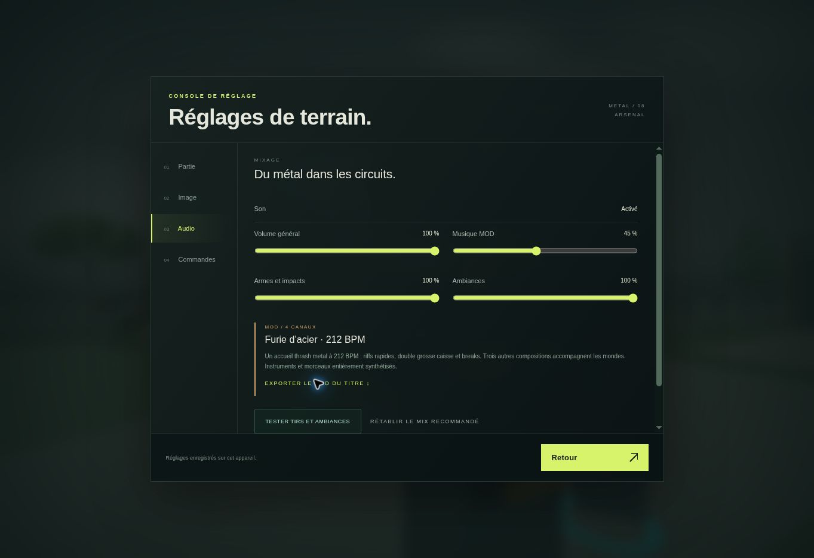

# METAL 0.8.1 — musique d’accueil

Date : 12 novembre 2026. Base : `673d6b2b80026103b4523fb0b3b16fb708556b06` sur `M4D135/METAL`.

## Ce qui change

« Furie d’acier » est une composition thrash metal originale à **212 BPM**, entièrement synthétisée par le code. Sa boucle dure **54,3396 secondes** : 48 mesures, 8 patterns, 12 séquences et 17 instruments. Deux prises de guitare distinctes, basse, double grosse caisse, caisse claire, cymbales, breaks et relances composent le morceau. Aucun enregistrement, riff ou mélodie existant n’est importé ou transcrit.

Le morceau utilise le même module ProTracker à quatre canaux pour la lecture et l’export. Le MOD de **183 704 octets** est généré en mémoire à la demande ; il n’est pas un asset distribué. Les trois musiques des mondes restent identiques octet par octet.

## Lecture et commandes

- Aucun périphérique audio ne s’ouvre avant un geste utilisateur.
- Le premier clic, toucher ou geste clavier sur l’accueil peut lancer le morceau sans lancer la simulation. Les boutons de départ gardent leur action directe.
- La commande « Écouter le thrash » / « Couper le son » affiche le titre et l’état de lecture.
- L’accueil et ses options partagent la piste ; chargement, partie, pause de combat et résultats gardent leurs états propres.
- Le volume général, la musique et le mute enregistrés restent respectés. Un volume nul n’est jamais remonté automatiquement.
- Une préparation tardive ne relance pas la piste après un départ en partie, un mute ou un masquage. Une reprise audio refusée peut être réessayée au geste suivant.
- La perte de focus ou le masquage coupe le titre et l’audition des réglages. Le retour au premier plan ne reprend aucun combat. Un chargement terminé hors focus aboutit en pause.
- Le retour au titre élimine l’atténuation laissée par un impact de combat ; les effets et ambiances du monde n’accompagnent pas le morceau d’accueil.
- L’export des options fournit `METAL-titre.mod` depuis l’accueil et le module du monde depuis une partie.

## Vérifications automatisées

| Vérification | Résultat |
| --- | --- |
| Référence 0.8.0 : `npm test` | 412 réussis, 0 échec, 0 annulé, 0 ignoré |
| Version finale 0.8.1 : `npm test` | **422 réussis, 0 échec, 0 annulé, 0 ignoré** |
| Tests musicaux inclus | 14, dont 3 nouveaux |
| Tests audio/shell inclus | 33, dont 7 nouveaux |
| Build `python3 tools/build.py` et test de distribution | PASS |
| HTML autonome | **803 375 octets bruts** ; 242 225 octets gzip |
| Ressources externes | **0** |

SHA-256 du HTML testé : `d9503acf09a33a9b2d0f90d598c0ac881250131ce0b3f70b74e1afc8c5df1b3b`.

Le build de référence a d’abord été reproduit et comparé au blob GitHub : 789 111 octets et SHA-256 `6c430ede63cec3b0b34b3369997c96885745ad0c98a4b0a21a9a411e415f4b68`. La mise à jour ajoute **14 264 octets bruts** et reste sous le budget de 1 400 000 octets, hors navigateur. Les durées des bancs ne sont pas des mesures de FPS.

Les nouveaux tests couvrent la structure/détermination du morceau, les caches et transitions titre/mondes, le plafond de voix, la préparation sans banque d’effets, l’isolation des ambiances, la restitution après audition, les gestes souris/tactile/clavier, le mute et les volumes, la visibilité/focalisation, les préparations concurrentes, la reprise audio refusée puis réessayée et le chargement terminé hors focus.

## Vérification dans un navigateur

Contrôles effectués dans Chrome cloud avec le rendu Canvas 2D de secours disponible dans cet environnement :

1. Affichage de V0.8.1 et du nom du morceau.
2. Premier clic sur le titre : passage à « Lecture · thrash metal original », en restant dans le menu.
3. Commande explicite d’écoute et options audio de l’accueil.
4. Volume musical à zéro, puis restauration à 45 %.
5. Départ dans le monde 1, pause, affichage de « Fer noir · 100 BPM » et export contextualisé au secteur.
6. Retour à l’accueil et restitution de « Furie d’acier · 212 BPM ».
7. Téléchargement du MOD de titre : comparaison **octet par octet** avec le module généré depuis les sources finales. SHA-256 : `88dfafde9f335f640c907cb709e96de72bc00d7a9fa6fb020a4625b08a08efe7`.
8. Aucune erreur JavaScript issue de la page observée dans les journaux capturés ; les erreurs d’extension du navigateur sont séparées.

Preuves : [relevé navigateur](qa-title-v081/browser.json), [capture de l’accueil](qa-title-v081/title-browser.jpg), [relevé de validation](qa-title-v081/validation.json).

## Limites

Les tests de souris/tactile/clavier et de changements d’onglet comprennent un banc de shell avec événements simulés. Le navigateur a vérifié l’interface et l’export réel ; cela ne constitue pas une écoute humaine du résultat, un essai sur téléphone physique, une mesure sur le matériel de l’utilisateur ni une validation de performances WebGL/GPU/NPU. Les mesures structurelles et PCM ne garantissent pas une appréciation musicale subjective.

Livraison de cette modification sur une branche dédiée du dépôt GitHub ; aucune fusion sur `main` ni publication d’un hébergement n’est effectuée dans cette reprise.
