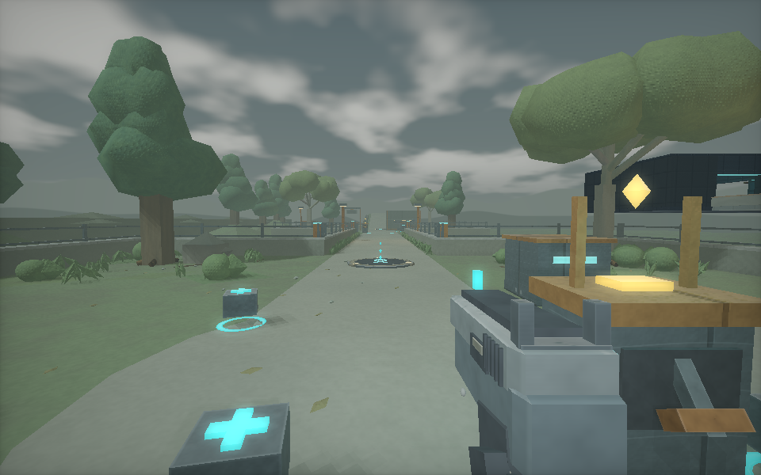
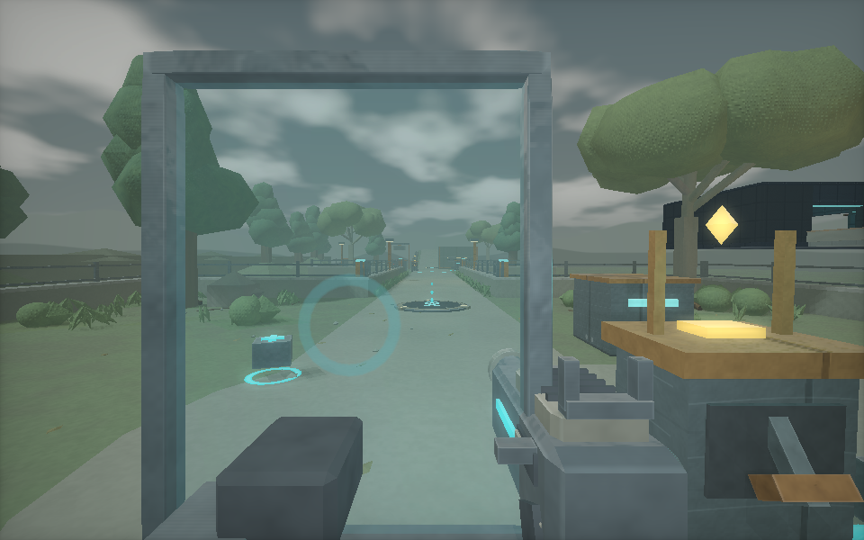
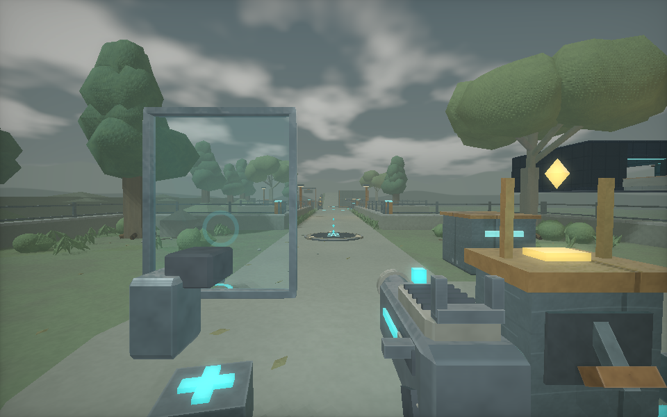
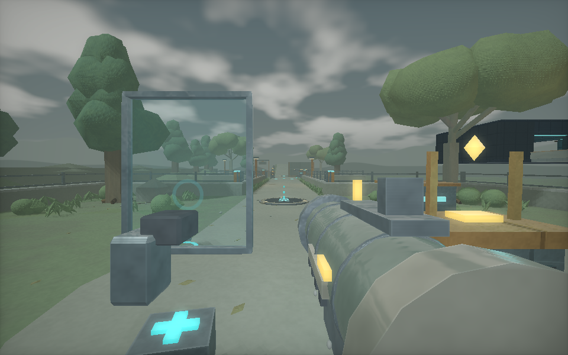

# Rendus de contrôle METAL 0.7

Ces images sont produites par le moteur du jeu, avec la géométrie et les matériaux procéduraux. Le banc enregistre les commandes WebGL2 puis les rejoue en OpenGL ES 3.2 sous **Mesa llvmpipe, rasterisation logicielle**. Les trois images de finition G sont figées à 960 × 600 ; elles ne constituent pas une mesure de FPS sur GPU matériel ni une capture de partie dans un navigateur.

## Construction d’un mob proche

Modèle réel de `FActors.build()`, cadré dans un studio de contrôle : plastron stratifié, ouvertures sombres, fixations et fourreaux des vérins. Les détails supplémentaires sont limités au niveau proche en WebGL auto/high.

## Extérieur du monde

Vue réelle du premier monde de campagne, graine 96 : relief, végétation procédurale, ciel et arme éclairée par l’environnement. Les reflets du ciel sont une approximation analytique, sans passe de miroir de la scène.

## Pistolet à la première personne

Le pistolet est celui de `game.models()`, produit par les sources de campagne après la phase D et les changements visuels G. Le banc vérifie que l’arme de départ équipée est l’identifiant 4. Aucun modèle d’arme n’a été reconstruit spécialement pour cette capture.

Les trois rendus ont passé la compilation des shaders, la validation des framebuffers et le contrôle des erreurs GL. Les empreintes des modules et des PNG sont consignées dans `captures.json`.

## Bouclier : correction H

Les comparaisons ci-dessous utilisent les vraies pièces de `game.models()`. Le banc équipe volontairement les armes et le bouclier dans le premier monde, graine 96, afin de conserver une scène identique : il ne représente pas une acquisition normale de cet équipement au monde 1. Les sources sont identifiées dans [bouclier-provenance.json](bouclier-provenance.json) ; elles précèdent l’assemblage final H de l’armure et du HUD.

| Avant correction | Garde corrigée |
| --- | --- |
|  |  |

Le panneau passe de 0,72 × 0,94 m à 0,52 × 0,66 m ; sa profondeur en garde augmente de 0,68 à 0,98 m. Les dix pièces restent assemblées, avec un cadre plus fin et un dégagement qui suit les mouvements de la main droite. Les modèles d’armes et leurs canons sont conservés exactement.

La projection des vraies primitives est vérifiée dans **3 500 poses** ciblées : cinq armes, quatre formats, repos/course/rotation/recul/mêlée, niveaux de garde et phases de frappe, aux FOV 60 et 110. Aucun chevauchement visible du cadre opaque avec l’arme n’apparaît dans ces poses. Le test échoue sur l’ancienne pose.

Les vues [au repos](bouclier-repos-mesa.png), [pendant la frappe](bouclier-bash-mesa.png) et [en portrait](bouclier-portrait-mesa.png) complètent la comparaison. En portrait, une partie du bouclier reste hors champ à gauche, tandis que le centre et l’arme restent dégagés. Les captures ne comprennent pas le HUD DOM et ne valident pas sa disposition.

Sept rendus natifs H (six PNG conservés ici, dont l’avant) ont passé les contrôles GL sur Mesa llvmpipe. Dans la scène SMG identique, les 1 529 instances et 130 088 triangles sont conservés ; le tri des transparents fait passer les appels de dessin de 52 à 53, sans nouvelle passe. Ce n’est pas une mesure de FPS matériel.

## Armure et limites de validation

[armor-preflight.json](armor-preflight.json) décrit trois collectes locales sur les véritables réserves des mondes 1, 10 et 16 : points et restes fractionnaires, puis reprise sans nouvel événement. Les positions initiales sont préparées pour isoler la collecte ; ce ne sont pas des parcours complets.

Le prévol Chromium a échoué avant toute page, car la création de son socket IPC est interdite dans cet environnement. [browser-preflight.json](browser-preflight.json) conserve ce résultat. Les tests du shell utilisent les vrais modules du jeu avec des APIs de navigateur substituées ; les images sont de la rasterisation logicielle GLES. Aucun essai humain complet, écoute humaine, test de téléphone physique, validation NPU ou gain de FPS sur GPU matériel n’est revendiqué.
