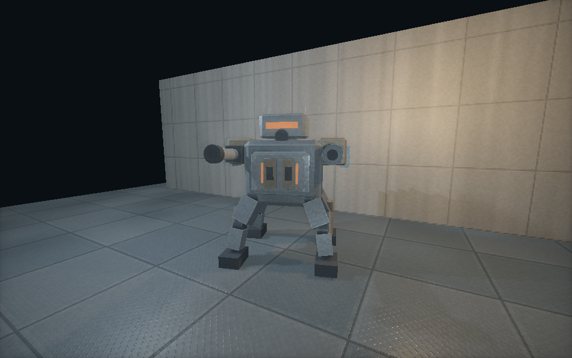
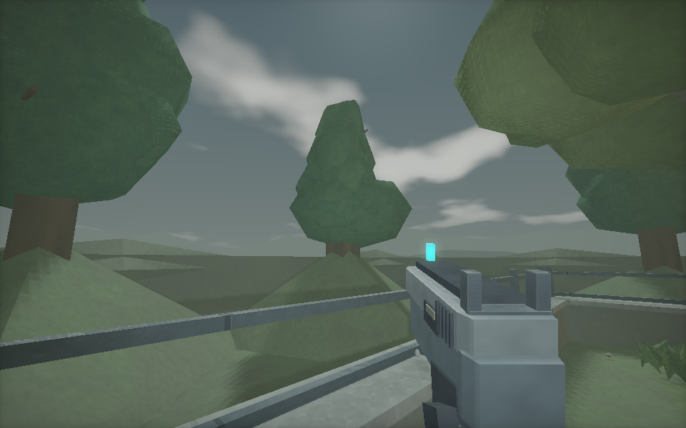

# Rendus de contrôle METAL 0.7

Ces images sont produites par le moteur du jeu, avec la géométrie et les matériaux procéduraux. Le banc enregistre les commandes WebGL2 puis les rejoue en OpenGL ES 3.2 sous **Mesa llvmpipe, rasterisation logicielle**. Les images sont figées à 960 × 600 ; elles ne constituent pas une mesure de FPS sur GPU matériel ni une capture de partie dans un navigateur.

## Construction d’un mob proche

Modèle réel de `FActors.build()`, cadré dans un studio de contrôle : plastron stratifié, ouvertures sombres, fixations et fourreaux des vérins. Les détails supplémentaires sont limités au niveau proche en WebGL auto/high.

## Extérieur du monde

Vue réelle du premier monde de campagne, graine 96 : relief, végétation procédurale, ciel et arme éclairée par l’environnement. Les reflets du ciel sont une approximation analytique, sans passe de miroir de la scène.

## Pistolet à la première personne

Le pistolet est celui de `game.models()`, produit par les sources de campagne après la phase D et les changements visuels G. Le banc vérifie que l’arme de départ équipée est l’identifiant 4. Aucun modèle d’arme n’a été reconstruit spécialement pour cette capture.

Les trois rendus ont passé la compilation des shaders, la validation des framebuffers et le contrôle des erreurs GL. Les empreintes des modules et des PNG sont consignées dans `captures.json`.
