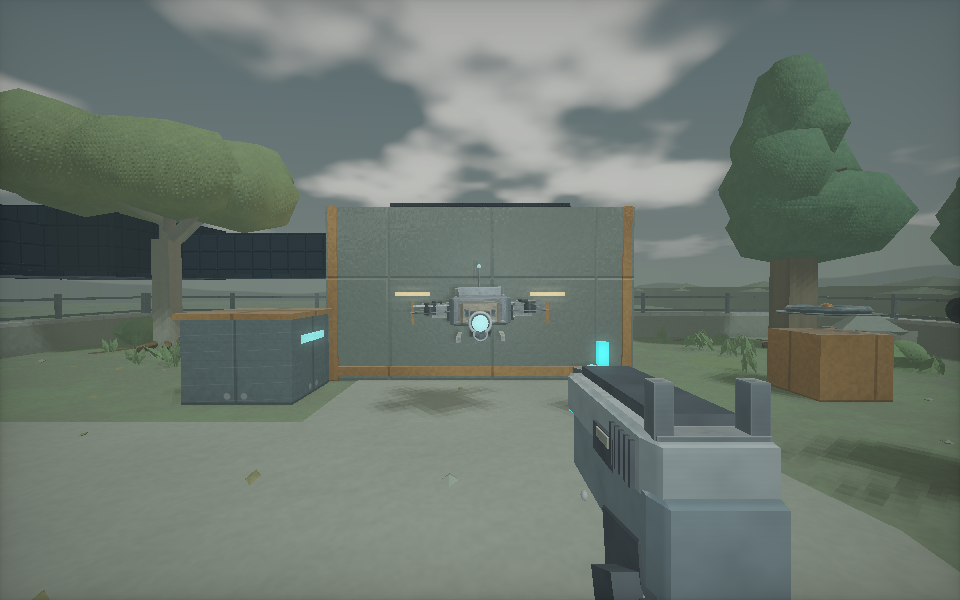
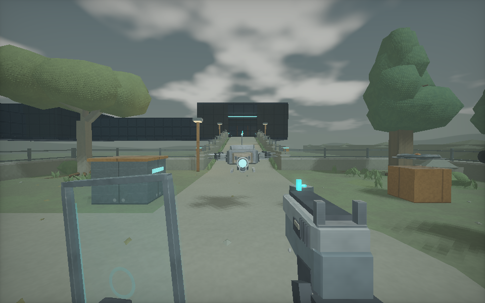
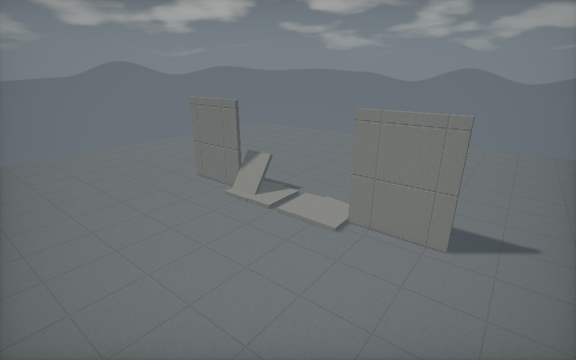
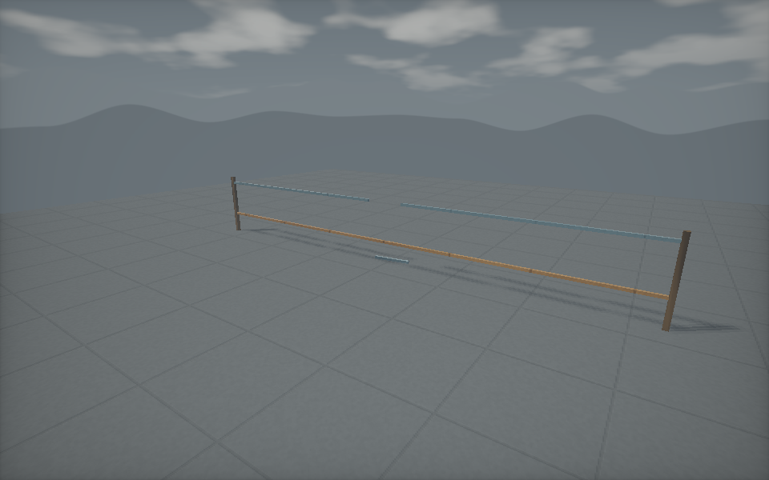
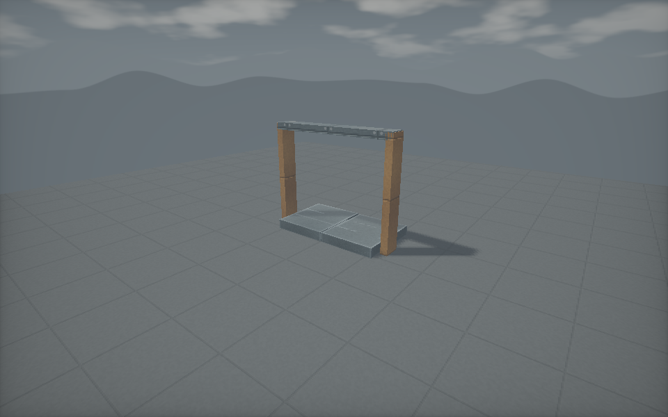
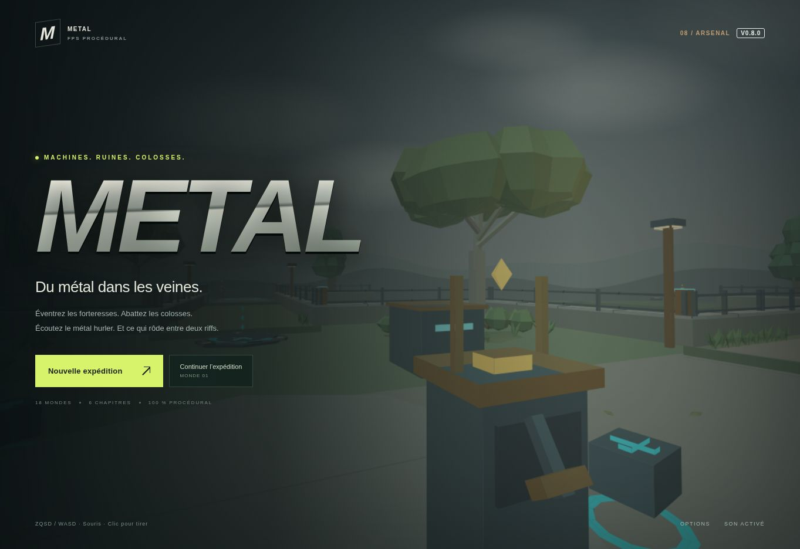
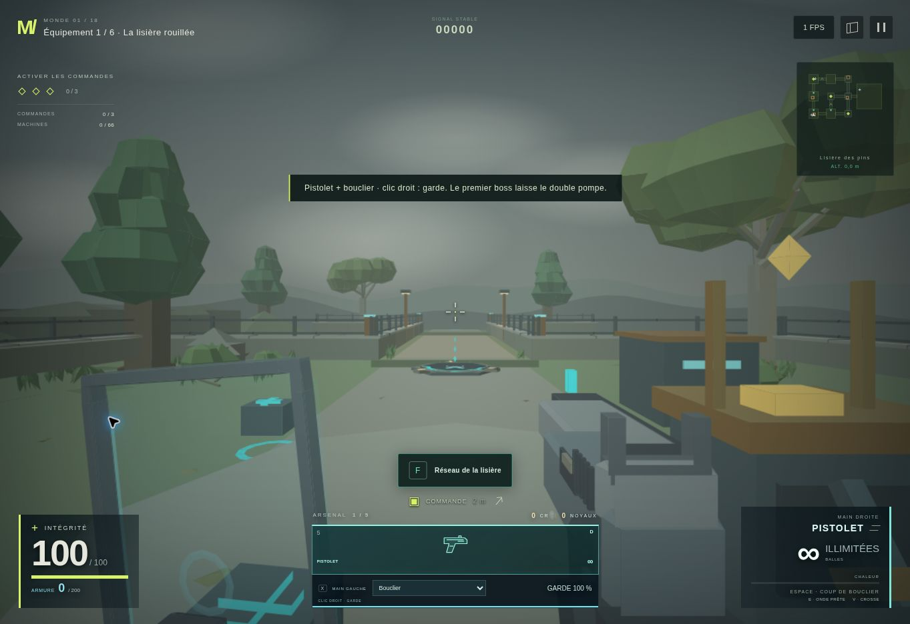
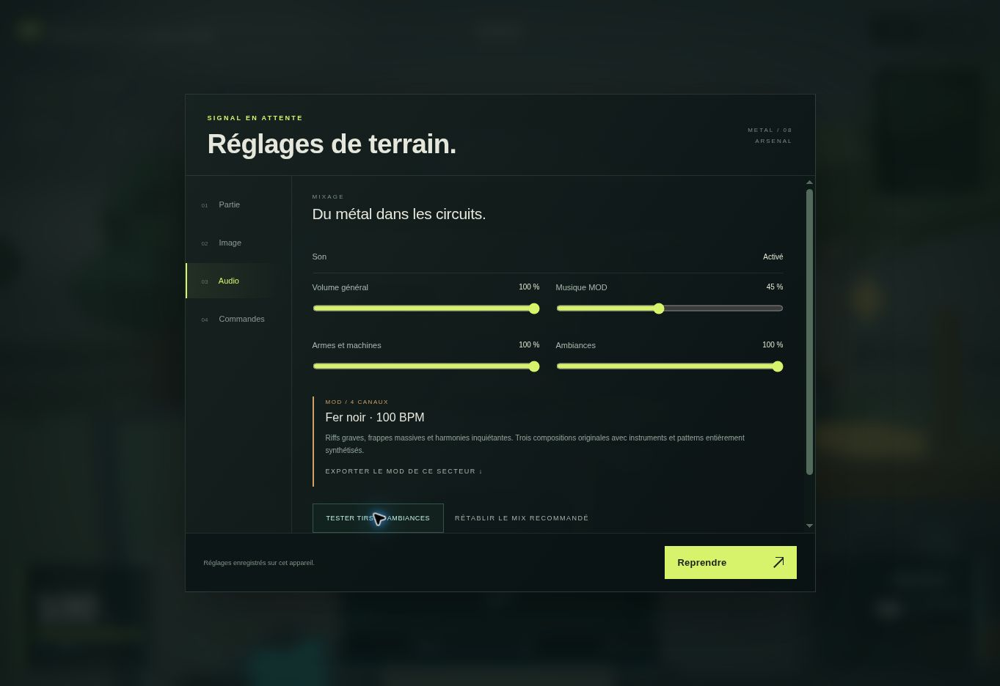

# Contrôles visuels et sonores de METAL 0.8

Ces fichiers documentent la suppression des panneaux artificiels, les morceaux de décor persistants, le démarrage avec pistolet et bouclier et la nouvelle synthèse sonore. Les images sont des preuves de contrôle, pas des ressources utilisées par le jeu. La distribution ne charge aucun de ces fichiers.

## Passage libéré

Les deux images utilisent la même caméra dans le monde 1, graine 96. Les appels du véritable renderer sont rejoués avec Mesa llvmpipe / OpenGL ES 3.2, en rasterisation logicielle. Les deux scènes terminent avec zéro erreur GL. Les sources, la caméra et les compteurs exacts figurent dans [capture-provenance.json](capture-provenance.json).

| Version précédente | Nouvelle campagne |
| --- | --- |
|  |  |

La génération v2 supprime les groupes `reinforcement_baffle`, `reinforcement_frame` et `reinforcement_mark`, ainsi que leurs collisions. La variante historique reste disponible pour reprendre les anciennes sauvegardes. Les captures ont été faites pendant l'intégration ; leurs empreintes sont conservées telles quelles. Les derniers ajustements des trajets de renforts et du calibrage ne sont pas une nouvelle mesure de ces images.

## Morceaux après destruction

Ces trois images proviennent de scènes contrôlées avec de vrais tirs dans `FSimulation`, la géométrie de `FDestruction` et les morceaux produits par `FEffects`. Elles utilisent le même rejeu GLES logiciel. Ce ne sont pas des captures d'une partie humaine.

| Élément | État observé après environ huit secondes |
| --- | --- |
| Mur architectural | Huit morceaux structurels au repos ; une brèche locale et la partie restante du mur. |
| Rambarde | Un segment détaché au sol ; les montants et rails non touchés restent présents. |
| Porte coulissante | Quatre plaques métalliques tombées dans l'encadrement. |

[destruction-scenes.json](destruction-scenes.json) conserve les compteurs des douze états avant/impact/chute/repos. Les noms de fichiers JSON qui y figurent désignent les scènes temporaires du banc de génération ; seuls les trois rendus au repos sont archivés ici. Les régressions reproductibles du dépôt sont dans `checks/destruction.test.mjs`, `checks/simulation.test.mjs` et `checks/effects.test.mjs`. Les débris restent décoratifs pour le joueur et la navigation ; ils ne forment pas des piles avec collisions entre morceaux.

## Contrôle de l'interface dans Chrome

L'aperçu local a été ouvert par l'interface du navigateur. Le titre affiche **V0.8.0**. Une nouvelle expédition affiche le pistolet à droite, le bouclier à gauche, l'armure **0 / 200**, l'arsenal **1 / 5** et la phase **Équipement 1 / 6**. Les options décrivent les six mondes d'équipement et les douze suivants. Le test sonore du menu de pause a été lancé ; son message de confirmation est visible.

Le navigateur distant n'exposait pas WebGL2 : il utilisait le secours Canvas 2D, avec environ 1 FPS observé. Ce résultat ne mesure pas une carte graphique matérielle. Aucune écoute humaine, partie complète, mesure sur téléphone ou validation multitouch n'est revendiquée. Le libellé du curseur d'effets a ensuite été précisé en « Armes et impacts » ; la capture conserve le libellé au moment du contrôle.

## Audio et combats contrôlés

[audio-pcm-metrics.json](audio-pcm-metrics.json) mesure les sons procéduraux secs à 22 050 Hz : durée, crête, RMS, composante continue et répartition spectrale. Il ne mesure pas la sortie audio d'un appareil ni le mix final du navigateur. Les régressions couvrent séparément les volumes, les voix prioritaires, la pause, les sources locales et l'occlusion.

[boss-ttk-final.json](boss-ttk-final.json) mesure trois combats dans la simulation réelle : boss 1 au pistolet, boss 6 avant les roquettes et boss 18 avec l'arsenal acquis. Le joueur reste à une position contrôlée, vise idéalement le cœur, conserve ses PV et commence avec des réserves pleines ; il ne ramasse rien pendant le combat. Les cadences, la chauffe, les projectiles et les fenêtres du cœur sont réels. Ces mesures vérifient que les améliorations et les munitions permettent de terminer ces combats ; elles ne donnent pas une durée de partie humaine.

Les profils se régénèrent avec `node tools/boss-profiles.mjs` ; les trois combats avec `node tools/boss-ttk.cjs`. La suite finale, les empreintes exactes de la distribution livrée et les limites de validation figurent dans [VALIDATION.md](../../VALIDATION.md) et [validation-v08.json](../validation-v08.json).
